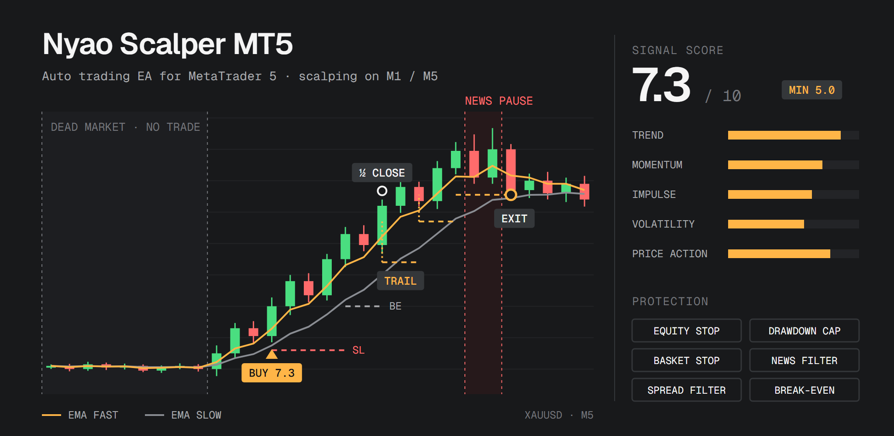

# Nyao Scalper v48.0



**Indicator-Based Signal Strength EA for MetaTrader 5**

> **Disclaimer:** This Expert Advisor is an experimental project for educational purposes. Trading Forex/CFDs involves significant risk. Past performance is not indicative of future results. Use at your own risk.

Nyao Scalper is an automated trading EA designed for scalping on lower timeframes (M1, M5). It uses a **weighted signal scoring system** that aggregates data from multiple technical factors (Trend, Momentum, Volatility, Price Action) into a single confidence score (0.0 - 10.0).

It includes position management, adaptive trailing stops, and lot sizing based on equity performance and signal quality.

## Key Features

### Signal Scoring

The EA scores buys and sells from 0.0 to 10.0 on every tick. `ScoreModel` chooses how (see [Strategy Logic](#strategy-logic)):

- **Trend score** _(default)_: how strongly price has trended over the last several hours: its position in the recent high-low range, its distance from a slow EMA, how efficiently it moved and its net move. Every part is continuous and directional, so the score changes smoothly and buy + sell always add up to 10.
- **Legacy score** (short-term confluence):
  - **Trend**: Fast/Slow EMA crossover and slope alignment.
  - **Momentum**: RSI "sweet spots" (trending ranges), breakouts, and candle body momentum. With `DirectionalBodyMomentum` (default on), a large candle only adds body and impulse points to the side it moved toward: a big bearish candle no longer raises the buy score.
  - **Impulse**: Detects price acceleration and directional continuity (consecutive candles).
  - **Volatility**: ATR-based analysis to detect chopping vs. trending markets.
  - **Price Action**: Penalizes signals with large opposing wicks (rejection) and rewards breakouts from local peaks.
- **Velocity** _(informational)_: Tracks the _change_ in signal score between bars and shows it on the dashboard. It is not used for any trading decision.
- **Blended Weighted Average Signal Smoothing**: Combining recent closed candle signals with a configurable dampened current candle contribution for improved responsiveness while maintaining signal stability.
- **Multi-Bar EMA Slope**: Trend slope is measured over `SlopeLookback` bars instead of a single bar, reducing M1 whipsaw.
- **Dead-Market Filter** _(off in the default profile: `MinVolRatioToTrade = 0`)_: When the last closed candle's ATR collapses relative to its average (`ATR/AvgATR < MinVolRatioToTrade`), new entries, re-entries and pending limits are blocked — the EA does not scalp a market too quiet to overcome costs. (Open positions are still managed normally.)
- **New-Bar Entry Evaluation** _(default on)_: With `EnableNewBarEntryOnly`, entries are evaluated once per closed bar on **closed candles only** (the forming candle is ignored for the entry decision, because on the first tick of a bar it is still empty). Position management still runs every tick. This removes intrabar signal repaint and makes backtests representative of live behavior.
- **Per-Tick Caching**: Signal scores are computed once per tick and cached, eliminating redundant calculations across position management, trailing, and dashboard systems.
- **Range Filter** _(off by default)_: `MinEfficiencyToTrade` blocks entries unless the last `RangeFilterPeriod` closed bars moved efficiently **in the signal's direction** (directional efficiency ratio = net move ÷ path travelled). In a sideways market the momentum score peaks right at the range edges — buying the top, selling the bottom — and this filter refuses those entries. Try `0.30` with a 20-bar lookback.
- **ATR-Based Stops** _(opt-in)_: every distance input type (`SLInputType`, `TPInputType`, `TSInputType`) accepts **ATR Multiple**, so stops and trailing scale with current volatility instead of fixed dollars that become too tight as price and volatility rise. `BreakEvenTriggerATR` and `TrailStartATR` delay the break-even lock and trailing until the trade has moved that many ATRs in its favor (0 = legacy dollar/spread triggers).
- **Regime & Trend Filters**:
  - **`EnableHTFTrendFilter`** _(on in the default profile, D1 EMA50)_: only allows buys above a rising higher-timeframe EMA, and sells below a falling one. `HTFMinDistancePct` (0.5 in the default profile, 0 = off) also requires the last closed higher-timeframe bar to close at least that % beyond the EMA, so entries are skipped while price hugs it and the trend is unclear.
  - **`RegimeScoreMode = Efficiency Ratio`** _(off, uncalibrated)_: replaces the ATR-expansion "chop" score with a directional Kaufman Efficiency Ratio (net move in the signal direction ÷ path travelled). This separates a clean trend from a volatile whipsaw.

### Risk & Equity Management

- **Equity Protection**:
  - **Min Equity Stop**: If equity falls below a specific dollar amount (`MinimumEquity`), closes everything and removes the EA from the chart.
  - **Max Drawdown Pause**: Pauses new entries (with growing pause lengths) when equity drops `100 − MinEquityPercent`% below its peak; `MaxMinEquityTriggers` turns repeated triggers into a full stop.
  - **Target Equity**: Optional absolute equity level (`TargetEquity`) at which the EA closes everything and stops for good (not a daily target).
- **Basket Stop**: Portfolio-level backstop. Closes **all non-chain** positions and pauses when their floating loss exceeds a % of equity (`MaxBasketLossPct`) — protects against compounding drawdown from stacked positions, independent of per-position stops.
- **Total Loss Hard Stop**: `MaxTotalLossPct` closes **everything, including hedge chains**, and pauses when the total floating loss crosses the limit. This is the one cap that bounds every position the EA holds.
- **Max-Spread Filter**: Blocks new entries when the spread is too wide (fixed `MaxSpreadPoints`, or auto-derived from ATR via `MaxSpreadATRRatio`). Critical for cost control on M1 gold.
- **Signal Dampening**: Position-aware system that penalizes signal scores when holding losing positions and raises entry thresholds during drawdown periods.
- **Loss-Streak Pause** _(`LossStreakPauseCount`, default 4, 0 = off)_: losing trades cluster — after a loss the next trade wins noticeably less often, i.e. the market is temporarily not suited to the signal. After N losses in a row the EA stops opening real trades and **paper-trades** every signal instead (same entry price, stop and first checkpoint/TP). Real trading resumes on the first paper win, or when a still-open real position closes in profit.
- **News Filter**: Automatically pauses new entries before and after high-impact news events. News, basket-stop and drawdown pauses each run on their own timer, so one can't cancel or shorten another.
- **Market-Close Filter**: Stops opening positions `MinutesBeforeClose` minutes before the symbol's quote session ends (daily break or weekend). Back-to-back sessions (e.g. 24:00 → 00:00) count as one continuous session.
- **Trading Hours**: Configurable start and end times to avoid low-liquidity sessions.
- **Leverage Guard**: Pauses new entries if account leverage changes and resumes when it's restored. `CloseAllOnLeverageChange` (default on) also closes all positions — set it off on brokers with dynamic leverage.
- **Restart-Safe State**: With `EnablePersistState` (default on) the EA saves its per-position and account-level state to `MQL5\Files\NyaoScalper\` and restores it after a terminal/VPS restart, recompile, input change or timeframe switch. Set `ResetSavedState = true` once to start fresh (then set it back to false). Not used in the Strategy Tester.
  - Open positions the saved state doesn't cover (no file, reset, or a crash before the save) are still protected. Each gets a stop if it has none, and its checkpoint exit is re-armed.
  - At terminal start the EA waits for the trade-server connection before reading the account.
  - Deposits and withdrawals shift the peak-equity baseline, so a withdrawal is never treated as a drawdown.

### Position Management

- **Duplicate Signal Filter**: Uses "Zone Points" and minimum distance multipliers to prevent over-stacking positions.
- **Adaptive Trailing** _(off in the default profile, which uses the checkpoint trailing stop instead)_:
  - Standard trailing stop logic.
  - **Signal-Based Adaptation**: Tightens or loosens TP/SL based on real-time changes in the Signal Score.
- **Loss Management** _(off in the default profile)_:
  - **Position Health Revalidation**: Continuously evaluates trade thesis using trend alignment, RSI zone, adverse ATR excursion, and swing structure — weighted health score determines hold/exit decisions.
  - **Scaled Partial Close**: Gradually reduces position volume as signal decays (75% → close 25%, 50% → close 50%, 25% → full exit). Each level is evaluated on its own; a level whose partial volume is below the broker minimum (e.g. 25% of 0.01 lot) is skipped, so the 25% full exit still fires on minimum-lot positions.
  - **Dynamic SL Tightening**: Pulls stop-loss closer proportionally as position health weakens below a threshold.
  - **Break-Even Lock**: Moves SL to entry price once profit exceeds spread cost, protecting gains.
  - **Virtual SL + Re-entry**: Closes positions at the health threshold, then immediately re-enters at the current (better) price if the signal is still valid. A re-entry goes through the same checks as a fresh entry (cooldown, per-candle limit, dampening, spread, HTF filter — only the duplicate-distance filter is skipped), and is skipped when a new position would fail the health check itself (otherwise it would just be closed again after its grace bars).
  - **Profit Offset SL**: Tightens SL of losing positions using accumulated profits from consecutive winning trades.

### Hedge Chain Recovery (Optional, Off in the Default Profile)

> ⚠️ **This is a martingale.** Lot size grows as a losing trade is hedged and re-hedged. It can recover many drawdowns smoothly but carries genuine **ruin risk** in strongly trending or choppy markets — it converts frequent small losses into rarer large ones. It is **opt-in** (`EnableHedgeChain`) and **off in the default profile**. Size `HedgeMaxLot` and the loss caps for an account you can afford to draw down.

> **What to expect:** a hedge is a new bet in the opposite direction, against the trend the original trade followed, so it cannot recover losses for free. A covered chain ends near break-even, a stopped chain loses its cap. With the trend-turn gate and the 1.5× SL cap it was roughly neutral in backtests; with a loose gate and a 5%-of-equity cap it lost noticeably.

When a position moves into loss by `HedgeTriggerATR × ATR` **and the reverse-direction signal confirms** (`HedgeRequireSignal`: the opposite-side score ≥ `HedgeMinSignalScore`, default 6.5: with the Trend score, the multi-hour trend has clearly turned against the position), the EA opens a reversed **hedge** and manages the pair as a *rolling chain* — at most two legs open at a time. The signal gate is an **anti-spike filter**: a wick that crosses the ATR trigger intrabar but isn't a real reversal won't have a strong opposite-side score, so no hedge is opened — the chain waits for the move to be confirmed (or the position to recover).

- **Recovery Sizing** (`HedgeAutoLot`): each hedge lot is *computed* so its profit covers `HedgeRecoveryPct%` of the leg it hedges within a `HedgeRecoveryATR × ATR` favorable move — instead of a blind fixed multiplier (which often can't catch up before price reverses). Falls back to `HedgeLotMultiplier` when auto-sizing is off, and is always clamped to `HedgeMaxLot`.
- **Covered**: hedge profit covers the older leg's current loss → close the older leg; the hedge graduates and trails to ride for more. Two safeguards on the graduated hedge:
  - **Recovery-locked SL**: its stop is floored at the price that keeps `HedgeRecoveryPct%` of the (now-closed) older leg's loss locked, so the pair can **never give back into a net loss** below the recovery target — the trail only ever rides the SL *above* that floor.
  - **ATR trailing**: because a graduated hedge carries a **large (martingale) lot**, it trails at **`HedgeTrailATR × ATR`** (lot-independent) rather than the dollar-based `TrailingDistanceValue` — a small dollar distance on a big lot becomes a near-zero price gap that would close the position instantly. Set `HedgeTrailATR = 0` to fall back to the normal trailing settings.
- **Roll**: hedge is losing but the older leg has recovered to break-even → close the older leg (free) and open a larger reverse hedge against the current one. Repeats up to `HedgeCycleLevels` per cycle.
- **Reseed**: at the cycle/lot limit, partial-close the deepest hedge by `HedgeCyclePartialPct%` and start a fresh, smaller cycle (up to `HedgeMaxCycles`) — capping lot growth instead of stacking ever-larger legs.
- **Exhausted → release** (not closed): once the chain can no longer expand (`HedgeMaxCycles` reached, or the `HedgeMaxLot` / `HedgeMaxTotalLots` ceiling hit with reseed off), the legs are **handed back to the adaptive loss management** — trailing, health-revalidation, partial close — and flagged so no new hedge is started on them. The chain is **not** force-closed at this point.
- **Chain loss stop** (`HedgeMaxChainLossSL` / `HedgeMaxChainLossPct` / `HedgeMaxChainLossUSD`; the tightest wins): closes the whole chain when its combined loss crosses the cap. It is checked **before** any roll. By default a chain may lose at most **1.5× the base lot's SL loss** ($30 with the default $20 stop at 0.01 lot) or 5% of equity, so it can never cost much more than the stop it replaced.
- **Entry gates**: anything that adds exposure — starting a chain, rolling to a bigger leg, reseeding a cycle — obeys the same blocks as a fresh entry: news window, pauses, trading hours, market close, leverage change and the spread filter. While blocked, an existing pair is simply held (still bounded by the chain loss stop and the total hard stop). Closing actions (covered, stop, release) always run.
- **Concurrency caps**: `HedgeMaxActiveChains` (default 1) limits how many chains can run at once, so a sharp reversal can't open a hedge for every stacked position on the same tick. `HedgeMaxTotalLots` caps the combined volume of all active chain legs; a roll that would exceed it reseeds or releases instead.

While a chain is active its legs are excluded from the standard trailing/loss-management **and from the portfolio basket stop** (a chain's transient drawdown must not trip it). They are still covered by their own chain loss stop and by the **total loss hard stop** (`MaxTotalLossPct`), which includes every position. Once released (or after a stop), the legs become normal positions again and the basket stop covers them. The first position's stop-loss is cleared on chain start (`HedgeClearRootSL`) — only after its hedge has actually been opened — so the chain logic alone governs the pair.

Chain state is saved to disk (see **Restart-Safe State**), so a restart doesn't turn live legs into "new" losing positions that start fresh chains. If no saved state exists, open positions whose comment starts with `Hedge L` are flagged so they never seed a new chain.

### Lot Sizing

- **Risk-Based Lot** _(`RiskPerTradePct`, default 1.25)_: each entry uses the largest lot whose stop-out loses at most this % of equity, capped at `MaxLotSize` (default 0.05), the broker limits and available margin. The lot is rounded down, and when even the broker's minimum lot would lose more, the entry is skipped instead of over-risking. With the default $20 stop: 0.01 lot on a $2,000 standard account (about 1% risk), 0.05 lot on a $100 cent account (10,000 cents), smaller lots as a balance shrinks, and no new trades on a standard account below about $1,600. Works only with a lot-independent stop (Points, ATR); set 0 to trade a fixed `BaseLotSize` instead.
- **Base Lot**: With `RiskPerTradePct = 0`, every entry starts at `BaseLotSize`, capped at `MaxLotSize`, the broker limits and available margin.
- **Drawdown Recovery Steps** _(`EnableDynamicLots`)_: Adds `LotStepSize` for every `EquityDropPercent`% the equity is below its peak — but **only** when the entry's signal score is at least `MinSignalStrengthForLot` (default 8.0). The score is a gate for these steps, not a separate lot boost. _Guardrails:_ capped at `MaxEquityDropLotSteps` total steps, and **disabled** while in a post-loss cooldown or while the basket is in floating loss — so size never scales up while actively bleeding.

### Dashboard & Alerts

- **On-Chart Dashboard**: Display of Signal Scores, Equity, Drawdown, hedge-chain usage and Statistics (refreshed once per second; hidden in non-visual backtests). Statistics count one trade per closed position (partial closes summed, entry commission included) and show **average win / average loss, expectancy per trade and profit factor** — the numbers that decide profitability, which a high win rate alone can hide.
- **Discord Integration**: Sends alerts to Discord via Webhook for:
  - Trade Open/Close
  - Equity Milestones
  - News Events
  - Trading Pauses/Resumes

## Strategy Logic

The EA scores both sides from **0.0 to 10.0** and opens a trade when a side's score reaches `MinBuySignalScore` / `MinSellSignalScore` (default **5.0**), only in the direction the D1 trend filter allows. `ScoreModel` chooses how the score is built.

### Trend Score (`ScoreModel = Trend`, default)

Four readings of the closed bars, each from -1 (strong down) to +1 (strong up), averaged into `s`:

| Part | Measures | Input (default) |
|---|---|---|
| Range | Where the close sits in the high-low range | `TrendRangeBars` (200) |
| EMA | Distance from the EMA, in ATRs (`TrendATRPeriod`, 14) | `TrendEMAPeriod` (200) |
| Efficiency | Net move / total path: a clean trend vs. a whipsaw | `TrendERBars` (100) |
| Momentum | Net move over the lookback, in ATRs | `TrendROCBars` (192) |

- **Buy score = 5 + 5s, sell score = 5 - 5s**, so the two always add up to 10: 5 means no trend, 7.5 a clear uptrend for buys (2.5 for sells).
- A small price change moves the score a little, never in fixed jumps, and nothing adds points for volatility alone.
- With the default minimum of 5.0 the EA buys while the multi-hour trend leans up and the D1 filter allows buys, and the mirror for sells. On M5 the lookbacks cover about 8 to 17 hours; scale them for other timeframes.
- The checkpoint hold (`CheckpointHoldMode = Score`) keeps a trade while its side still scores higher, i.e. while the multi-hour trend agrees.
- The dashboard shows the four parts as `Rng`, `EMA`, `Eff` and `Mom`.

> **Why it is the default:** on XAUUSDm M5 history, the legacy parts that only look at the last few bars (EMA 5/12, RSI 8, candle shape) and its direction-blind volatility points barely separated winning entries from losing ones, and the score jumped 1 to 3 points on tiny price changes. Multi-hour trend readings carried the most information. It is still a modest edge: the score measures trend strength, it is not a probability.

### Legacy Score (`ScoreModel = Legacy`)

The original short-term confluence score; use a minimum of about 6.0 with it. It sums weights from these components:

1.  **Trend Score (Max 3.0)**:
    - **Alignment (+1.5)**: Fast EMA > Slow EMA (Buy) or Fast EMA < Slow EMA (Sell).
    - **Slope (+1.5)**: Fast EMA is rising (Buy) or falling (Sell).

2.  **Momentum Score (Max 3.0)**:
    - **RSI Sweet Spot (+1.0)**: RSI between 50-80 (Buy) or 20-50 (Sell).
    - **RSI Breakout (+0.5)**: RSI crossing key levels (60 for Buy, 40 for Sell).
    - **Body Momentum (+1.5)**: Current candle body is larger than the recent average.
    - **Impulse Boost**: Momentum score is multiplied by `(1 + ImpulseStrength)` where impulse combines:
      - Body acceleration (current vs. average body size)
      - Range expansion (current vs. average candle range)
      - Directional continuity (consecutive same-direction candles)

3.  **Volatility & Structure (Max 4.0)**:
    - **Chop Filter (Max 2.0)**: By default (`RegimeScoreMode = ATR Expansion`) the ATR ratio classifies the regime. Note this measures volatility *expansion*, not direction — a volatile whipsaw can score as a trend. `RegimeScoreMode = Efficiency Ratio` scores directional efficiency instead (`ERHighThreshold` / `ERMedThreshold`). In a low tier the score contributes `0.0` by default — no free points.
    - **Volatility (Max 1.0)**: Expanding volatility (ATR ratio > 1.2) adds to the score; a quiet market adds `0.0` by default.
    - **Dead-Market Block**: If the last closed candle's `ATR/AvgATR < MinVolRatioToTrade`, entries are blocked (the market is too quiet to scalp).
    - **Peak Breakout (+1.0)**: Price breaking above/below local extremes (recent 5-bar high/low).

4.  **Penalties (Deductions)**:
    - **Wick Rejection**: Long opposing wicks (e.g., long upper wick on a Buy signal) reduce the final score by the wick-to-body ratio.

> **Calibration note:** The Chop and Volatility components add nothing in a dead or quiet market (their low tiers default to `0.0`), so the score separates market regimes rather than rewarding every market. When `ATR/AvgATR` falls below `MinVolRatioToTrade`, the score is forced to `0` (no trade).

**Note:** All scoring weights (Trend, Momentum, Volatility, etc.) are **fully adjustable** in the EA settings, allowing you to customize the strategy's sensitivity to different market conditions.

> **What the legacy score is (and isn't):** most components — EMA alignment and slope, RSI, candle body, breakout, consecutive candles — all measure "price has been rising/falling over the last few bars", so they are strongly correlated. The 0-10 score is a momentum confluence count, not a probability. Thresholds are best treated as tuning knobs to validate out-of-sample, not as confidence levels.

### Both Models

- **Dead-Market Block**: if the last closed candle's `ATR/AvgATR < MinVolRatioToTrade`, entries are blocked (off by default).
- **Velocity Tracking** _(informational)_: tracks the _change_ in signal score between bars and shows it on the dashboard (`Vel`). It does not drive trailing or lot sizing.
- **Signal Smoothing (Blended Weighted Average)**:
  - Combines weighted average of recent closed candles with a dampened current candle contribution.
  - **SignalSmoothingCandles**: Number of closed candles to average (1-10, default 2).
  - **CurrentCandleBlend**: Weight factor for the forming candle (0.0-1.0, where 0.0 = closed candles only, 1.0 = current candle only). Used for position management. With `EnableNewBarEntryOnly` (default), **entry decisions use closed candles only** — on the first tick of a bar the forming candle has no body or range yet and would only drag the score down.
  - Results in smooth yet responsive signal scoring that adapts to market conditions.

**Entry Condition**: the side's score >= `MinBuySignalScore` / `MinSellSignalScore` (plus the HTF trend filter and the entry guards)

### Entry Execution (Market vs. Limit)

By default, a qualifying signal opens **at market** (current Ask/Bid). Optionally, fresh entries can be placed as a **pending pullback limit** instead:

- **`EnableLimitEntry`** _(default off)_: When on, a fresh signal places a Buy Limit below the Ask (or Sell Limit above the Bid), aiming for a better fill on a small retracement rather than chasing the move at market.
- **`LimitEntryAnchor`**: Where the limit is placed —
  - **Fixed ATR** _(default)_: a flat depth of `LimitEntryATRFraction × ATR` below/above price. Simplest; easiest to reason about.
  - **EMA**: at the fast EMA (a natural M1 retracement target).
  - **Swing**: at the recent swing low/high (`HealthSwingLookback` bars) — pure structure.
  - **Smart**: the *nearer-to-price* of the swing level and the fast EMA, so the limit lands at a price that means something.
  - For EMA/Swing/Smart, `LimitEntryATRFraction` acts as a **cap** — the limit is never placed deeper than that ATR fraction (so you never wait absurdly far), and it always respects the broker stop level. If no valid level sits on the pullback side, it falls back to the fixed depth.
- **`LimitEntryATRFraction`**: Fixed pullback depth (Fixed-ATR mode) / maximum pullback cap (EMA/Swing/Smart modes), as a fraction of ATR.
- **`LimitEntryExpiryBars`**: Cancels an unfilled limit after N bars (managed internally, broker-agnostic). When the symbol supports it, the order also gets a broker-side expiry one bar later as a backstop in case the EA isn't running.
- **`LimitEntryCancelOnFlip`**: Cancels the pending if the directional signal drops back below its threshold before filling.
- **Safety**: All pending limits are cancelled whenever new entries are blocked (news, pause, trading hours, market close, leverage change), when an equity stop fires, and when the EA is removed — a resting limit can never fill into a window the EA meant to avoid, or fill unmanaged.
- **Scope**: This affects **fresh entries only**. Virtual-SL re-entries always execute at market — their purpose is to restore exposure immediately, so they must not risk going unfilled.

> **Trade-off:** A pullback limit improves average fill price but **lowers fill rate** — strong momentum/breakout moves (which this EA's scoring favors) often run without retracing, so the best moves may be missed while weaker, stalling signals fill preferentially. Backtest both modes before committing; it is off by default for this reason.

### Checkpoint Exit (On in the Default Profile)

With `EnableCheckpointExit` the take-profit is **not sent to the broker** — it becomes a **checkpoint**. When price reaches it, the EA re-checks the trade instead of closing it:

- **Still valid → keep it.** The SL is moved to lock `CheckpointLockPct`% of the move (default 50%), and the next checkpoint is set one TP-distance further. This repeats as long as the trade keeps qualifying, so winners can run with the trend while profit is progressively locked.
- **No longer valid → close** at the checkpoint.
- **What "valid" means** (`CheckpointHoldMode`): the higher-timeframe trend still agrees (uses the `EnableHTFTrendFilter` settings — turn it on), the signal score still points the same way, or both.
- **Trailing stop** (`CheckpointTrailPct`, `CheckpointTrailStartPct`; 0 = off): both are a **% of the checkpoint distance** (the TP distance), so they follow it automatically if you change it. Once the trade is `CheckpointTrailStartPct`% of that distance in profit, the SL follows the price `CheckpointTrailPct`% of it behind and never moves back. With a start of 0, trailing begins after the first held checkpoint. The checkpoint lock still applies, and whichever stop is tighter wins. The default profile uses 100% / 50%: with its $20 checkpoint, the SL trails $20 behind the price from +$10.
- **Break-even lock** (`CheckpointBreakEvenPct`, default 0 = off): once the trade is this % of the checkpoint distance in profit, the SL moves to the **smallest possible profit**: one tick beyond the entry plus commission and any negative swap. On a fast market the stop can still fill a little below that level.
- **All checkpoint settings at a glance:**
  - distance: `TPInputType` / `TPValue`
  - what keeps a trade: `CheckpointHoldMode`
  - profit locked per checkpoint: `CheckpointLockPct`
  - trailing distance and start: `CheckpointTrailPct` / `CheckpointTrailStartPct`
  - loss-side skips: `CheckpointMaxSkips`
  - early exit when the trend turns: `TrendFlipExitScore`
  - smallest-profit lock: `CheckpointBreakEvenPct`
- **Loss side** (`CheckpointMaxSkips`, default 0 = off): when the SL is touched while the signal score still agrees, the stop may be pushed one SL-distance further, at most this many times. The broker always holds a **hard stop at the maximum distance** (`(1 + skips) × SL`), so the worst case is fixed even if the EA or terminal is offline; the inner stops are managed by the EA. Risk sizing uses the full worst-case distance.
- **Trend-flip exit** (`TrendFlipExitScore`, default 6.0, 0 = off): a losing trade is closed as soon as the **opposite** side's closed-candle score reaches this value, i.e. the trend it was opened with has turned against it, instead of waiting for the full SL. With the Trend score, 6.0 to 7.0 means the multi-hour trend has clearly reversed. It cut the average loss in backtests without hurting results. Hedge chain legs are left to the chain logic.

### Risk:Reward TP/SL (Optional)

By default the EA places SL and TP from the manual **Trailing TP/SL** inputs (`SLValue` / `TPValue`). Enabling **Independent Risk:Reward** instead derives *both* stops from a single risk leg and a target ratio — so every trade carries the same R:R geometry regardless of the manual TP/SL tuning.

- **`EnableRiskReward`** _(default off)_: When on, the R:R engine **overrides** the manual Stop Loss *and* Take Profit entirely — `EnableStopLoss` / `SLValue` and `EnableTakeProfit` / `TPValue` are ignored for fresh entries.
- **`RRRiskMode`**: How the **risk (SL) leg** is sized —
  - **Auto (ATR-Based)** _(default)_: `SL distance = ATR × RRAtrMultiplier`, computed per entry from the last closed bar's ATR — the stop scales with current volatility.
  - **Manual Distance**: a fixed SL distance from `RRRiskValue`, in the units set by `RRRiskInputType`.
- **`RRRiskInputType`**: Units for the manual risk distance (Dollar Amount / Percent of Equity / Points) — used only when `RRRiskMode = Manual`.
- **`RRRiskValue`** _(default 200)_: Manual SL distance for the risk leg (used only when `RRRiskMode = Manual`).
- **`RRAtrMultiplier`** _(default 1.5)_: ATR multiple for the SL leg (used only when `RRRiskMode = ATR`).
- **`RiskRewardRatio`** _(default 1.5)_: Reward-to-risk ratio — `TP distance = SL distance × RiskRewardRatio`. The default targets 1.5× the risked distance in profit (a 1:1.5 R:R).

Once set at entry, the **TP is fixed at the R:R level** — the adaptive trailing system will *not* recompute or overwrite it, so the intended reward target is preserved for the life of the trade. Trailing and break-even still manage the **SL** as normal. Applies to both market and pullback-limit entries.

> **Scope:** This is a per-entry geometry override, independent of the per-trade and basket equity stops, which still apply. Leave it off to keep the manual/adaptive TP/SL behavior.

## Settings Profile

`settings/default.set` is the only bundled profile. It holds the same values as the EA's built-in input defaults, so attaching the EA without loading anything gives the same setup. To load it, attach the EA to a chart, open the **Inputs** tab, click **Load** and pick the file (in the Strategy Tester: right-click the inputs list → **Load**). The file lists every input, so loading it fully defines the EA's behavior.

| default | |
|---|---|
| Symbol / timeframe | Gold (written for XAUUSDm, 3-digit quotes; 2-digit brokers are rescaled automatically) on **M5** |
| Entries | Trend score ≥ 5 (the multi-hour trend agrees), only in the D1 trend direction (close at least 0.5% beyond a rising / falling EMA50) |
| Stop | Fixed $20 move (20000 points on 3-digit quotes) |
| Lot size | Largest lot that loses at most 1.25% at the stop (`RiskPerTradePct`), capped at 0.05: 0.01 lot on $2,000, 0.05 lot on a $100 cent account |
| Exit | Checkpoint every $20: held while the score agrees (locking 50%), otherwise closed; $20 trailing stop from +$10; a losing trade is closed early once the trend flips against it (opposite score ≥ 6) |
| Loss-streak pause | After 4 losses in a row, paper-trades until a paper win |
| Hedge chain | Off |
| Account | **Standard account: $2,000 or more** (0.01 lot risks $20, about 1%; below about $1,600 the EA opens no new trades). **Cent account: $100 or more** (10,000 cents, 0.05 lot, the same ~1%). A standard account under $2,000 can't trade the profile safely: the broker's minimum lot already risks more than 1.25% |

> **Brokers with other quote decimals**: point values are written for a 3-digit gold quote (0.001), and `PointInputDigits` (default 3) rescales them to the symbol's own decimals so every distance keeps the same price meaning. Where gold is quoted with 2 decimals, 20000 points become 2000, still a $20 move, instead of a $200 stop with 10× the risk. This covers `SLValue`, `TPValue`, `TrailingDistanceValue` and `RRRiskValue` when their type is Points, plus `ZonePoints` and `MaxSpreadPoints`. The EA prints a `[POINTS]` line at start-up when it rescales. Set `PointInputDigits = 0` to use point values exactly as typed (for example on forex, where your own values are written for that symbol).

## Installation

1.  **Copy File**:
    Place `nyao_scalper.mq5` into your MetaTrader 5 `Experts` folder.
    - File -> Open Data Folder -> MQL5 -> Experts

2.  **Dependencies**:
    Ensure the `Controls` and `Generic` standard libraries are available (standard in MT5). No DLLs are used.

3.  **Allow WebRequest** (For Discord Alerts):
    - Go to `Tools` -> `Options` -> `Expert Advisors`.
    - Check "Allow WebRequest for listed URL".
    - Add your Discord Webhook URL (if using alerts).

4.  **Compile**:
    Open the file in MetaEditor and press `F7` or click "Compile".

5.  **Run**:
    Drag the EA onto an **M5** chart. Its built-in defaults are the `default.set` profile.
    - The built-in defaults (= `default.set`) are made for **XAUUSDm on M5** with 3-digit quotes and a **$2,000+ standard** or **$100+ cent** account (see the Account row above).
    - 2-digit gold quotes are rescaled automatically (`PointInputDigits`); for other symbols set your own distances (see [Settings Profile](#settings-profile)).
    - Requires a **hedging** account (the EA refuses to start on netting accounts).
    - When an equity stop fires (Min Equity, Target Equity or Max Times Trigger), the EA closes all its positions and pending orders and then **removes itself from the chart**. Other EAs in the terminal keep running.

## Alternative Compilation (VS Code)

If you prefer coding in Visual Studio Code, you can compile `.mq5` files directly using the **MQL5/MQL4** extension (also known as Buraq).

1.  **Install Extension**:
    - Open VS Code Extensions (`Ctrl+Shift+X`).
    - Search for `Buraq MQL5` or `sarfrazfrompk`.
    - Install **[MQL5/MQL4](https://marketplace.visualstudio.com/items?itemName=sarfrazfrompk.buraq-mql5-mql4)** by `sarfrazfrompk`.

2.  **Configure Path**:
    - Go to Extension Settings (`Ctrl+,`).
    - Search for `MQL5`.
    - Set `Mql5: Metaeditor Path` to your `metaeditor64.exe` location.
    - _Example:_ `C:\Program Files\MetaTrader 5\metaeditor64.exe`

3.  **Compile**:
    - Open `nyao_scalper.mq5` in VS Code.
    - Right-click anywhere in the code.
    - Select **MQL5: Compile**.
    - Check the Output terminal for success or errors.

## Backtesting Honestly

The EA uses no DLLs, so it runs on local agents and on the MQL5 Cloud Network. State persistence is disabled in the tester (every test starts clean).

Results in the Strategy Tester only mean something if the test mirrors live conditions. For this EA specifically:

1.  **Use "Every tick based on real ticks"** (Strategy Tester → Modeling). Entries are decided on bar close, but almost everything after the entry — trailing, health exit, partial close, SL tightening, hedge chain start/roll and virtual-SL re-entries — is evaluated **every tick**. `1 minute OHLC` can be used for a fast first sweep, but only real-tick results mean anything for this EA (especially with the hedge chain on). Set `ReentryRespectsNewBarGate = true` if you want re-entries to also wait for bar close.
2.  **Include realistic costs.** Set your broker's **commission** in the tester and test on a **realistic spread** (ideally the symbol's actual spread, not 0). On M1 XAUUSD, spread + commission is the dominant cost — a backtest without them is meaningless.
3.  **Know what the tester can't see.** `CalendarValueHistory` (the high-impact **news filter**) generally returns nothing inside the Strategy Tester, so backtests run **without** news protection that live trading has. Treat tester drawdowns around news as optimistic.
4.  **Validate out-of-sample.** With this many tunable inputs, in-sample optimization overfits easily. Tune on one period, then confirm on a separate untouched period (or use walk-forward) before trusting a profile.
5.  **Sanity-check guards** via the journal (`EnableLogging = true`): confirm entries fire only on bar close, that trades are skipped when spread is wide or ATR has collapsed, that no entries or hedge starts happen in the `MinutesBeforeClose` window, and that the **Basket Stop** / **Total Loss Hard Stop** close positions once floating loss crosses their limits.
6.  **Judge expectancy, not win rate.** Tight trailing locks in small wins while the hard stop is much wider, so a high win rate is built into the design and says little on its own. Look at average win vs. average loss, expectancy per trade and profit factor (shown on the dashboard and in reports), plus the worst drawdown.

> Capture your own report with the tool below (real ticks + your broker's costs, out-of-sample) before running the EA on a funded account.

### Automated Backtests (`tools/backtest`)

[`tools/backtest/nyao_backtest.py`](tools/backtest/nyao_backtest.py) runs Strategy Tester passes from the command line and writes a report to `reports/<name>/`.

**Requirements:**
- Windows
- MetaTrader 5, logged in to your broker at least once; the tester uses that account and its tick history
- Python 3.8+ (standard library only)

```bash
# Default profile on M1 and M5, one real-tick run per month (each month starts from a fresh $2,000)
python tools/backtest/nyao_backtest.py run --name default-2026-real-ticks --periods M1,M5 --from 2026-01 --to 2026-09

# Your own settings file, one timeframe, quick 1-minute-OHLC sweep
python tools/backtest/nyao_backtest.py run --name my-settings-m5 --set settings/my-settings.set --periods M5 --from 2026-03 --to 2026-06 --model ohlc

# Rebuild reports/<name>/ from the tester reports already in the terminal folder
python tools/backtest/nyao_backtest.py report --name default-2026-real-ticks
```

**What `run` does:**
1. Compiles `nyao_scalper.mq5` from this repo into `MQL5\Experts\NyaoBacktest\`. Your own compiled EA is not touched.
2. Installs the `.set` file as a tester profile.
3. **Closes MetaTrader 5**, the way clicking X does. It never force-closes, so save your work first. The tester can't start while the terminal is open.
4. Runs one test per timeframe × month at below-normal priority on half the CPU cores. The tester window opens on its **Graph** tab.
5. Reopens MetaTrader 5.
6. Writes the report:
   - `summary.md`: tables and the balance graph of every run (renders on GitHub)
   - `index.html`: the same, for the browser
   - `results.csv`, `graphs/` and `plan.json`

| Option | Default | Meaning |
|---|---|---|
| `--name` | (required) | Report folder `reports/<name>/` |
| `--set` / `--ea` | `settings/default.set` / `nyao_scalper.mq5` | Settings file and EA source in this repo |
| `--periods` | `M1` | Comma-separated timeframes, e.g. `M1,M5` |
| `--from` / `--to` | (required) | First and last month, `YYYY-MM` |
| `--split` | `monthly` | `monthly` (fresh deposit each month) or `whole` (one run over the range) |
| `--model` | `real` | `real` (real ticks), `every` (generated ticks), `ohlc` (1-minute OHLC), `open` |
| `--symbol` / `--deposit` / `--leverage` | `XAUUSDm` / `2000` / `500` | Test account |
| `--terminal` / `--data-dir` | auto-detected | Path to `terminal64.exe` and its data folder |
| `--cpu-mask` | every other CPU | Affinity for the tester, e.g. `0x555`; `0` = all CPUs |
| `--keep-raw` | off | Also copy the raw MT5 reports to `reports/<name>/raw/` (git-ignored, large) |
| `--no-reopen` / `--timeout-min` | off / `30` | Leave the terminal closed afterwards; abort a single run after N minutes |

The **Tick data** column in the summary shows whether each run really used real ticks ("100% real ticks"). Brokers only keep real ticks for a limited period; before that, the tester generates ticks from M1 bars.

## Credits

**Author**: Elriz Wiraswara<br/>
**License**: BSD-3-Clause (Open Source)<br/>
**Repository**: [https://github.com/elrizwiraswara/nyao_scalper_mt5](https://github.com/elrizwiraswara/nyao_scalper_mt5)

> **Disclaimer:** I do not sell or commercialize this EA under my name. If you encounter anyone selling it claiming to represent me, please treat it as a scam and report it.
