# Default profile - XAUUSDm M1 vs M5, Jan-Dec 2025

| Setting | Value |
|---|---|
| EA | Nyao Scalper v47.0 (`nyao_scalper.mq5`) |
| Settings | `settings/default.set` |
| Git commit | 679fbe5 |
| Symbol / timeframes | XAUUSDm / M1, M5 |
| Tick data | Generated from 1-minute bars (no real tick history for this period) |
| Deposit / leverage | 2,000 USD / 1:500 |
| Runs | One run per month, each starting from a fresh deposit |
| Generated | 2026-10-15 23:36 with `tools/backtest/nyao_backtest.py` |

## Summary

Total return is the sum of the monthly returns (each month starts from the same deposit, not compounded).

| Timeframe | Total return | Profitable | Best / worst run | Max drawdown | Trades | Win rate | Avg win / loss | Profit factor | Tick data |
|---|---|---|---|---|---|---|---|---|---|
| M1 | +25.2% | 7/12 | +16.7% / -3.9% | 14.1% | 916 | 24% | $21.41 / -$6.00 | 1.12 | 0% real ticks |
| M5 | +66.2% | 10/12 | +16.9% / -2.2% | 11.7% | 515 | 42% | $22.13 / -$11.56 | 1.38 | 0% real ticks |

## Results per run

| Run | M1 | M5 |
|---|---|---|
| 2025-01 | -0.7% (DD 4%, 46 trades) | +3.7% (DD 3%, 26 trades) |
| 2025-02 | +2.0% (DD 6%, 51 trades) | +7.4% (DD 3%, 28 trades) |
| 2025-03 | -3.9% (DD 5%, 60 trades) | +6.1% (DD 4%, 32 trades) |
| 2025-04 | +9.7% (DD 9%, 104 trades) | +13.8% (DD 7%, 62 trades) |
| 2025-05 | -0.6% (DD 8%, 82 trades) | +5.1% (DD 11%, 44 trades) |
| 2025-06 | +0.3% (DD 8%, 59 trades) | -2.2% (DD 9%, 27 trades) |
| 2025-07 | +1.6% (DD 3%, 30 trades) | +1.8% (DD 4%, 15 trades) |
| 2025-08 | -0.3% (DD 4%, 41 trades) | -0.1% (DD 5%, 22 trades) |
| 2025-09 | +16.7% (DD 6%, 91 trades) | +16.9% (DD 4%, 48 trades) |
| 2025-10 | +3.0% (DD 7%, 153 trades) | +6.9% (DD 12%, 99 trades) |
| 2025-11 | -3.6% (DD 14%, 100 trades) | +2.4% (DD 9%, 54 trades) |
| 2025-12 | +1.0% (DD 9%, 99 trades) | +4.3% (DD 9%, 58 trades) |

## Balance graphs

### M1

**2025-01** -0.7%

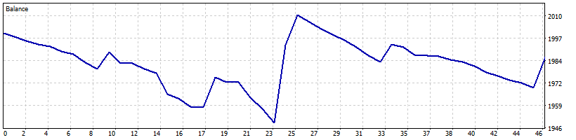

**2025-02** +2.0%

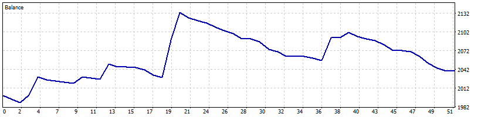

**2025-03** -3.9%

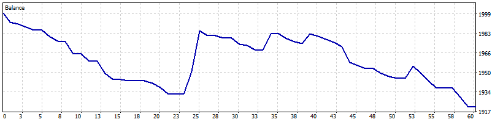

**2025-04** +9.7%

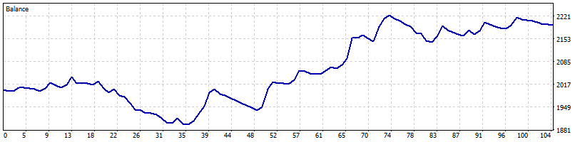

**2025-05** -0.6%

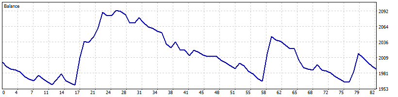

**2025-06** +0.3%

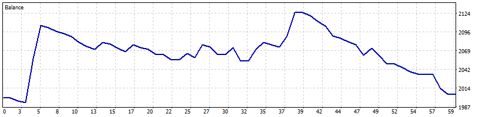

**2025-07** +1.6%

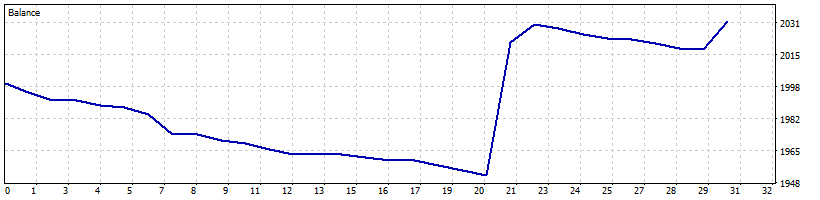

**2025-08** -0.3%

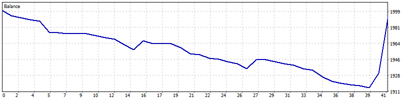

**2025-09** +16.7%

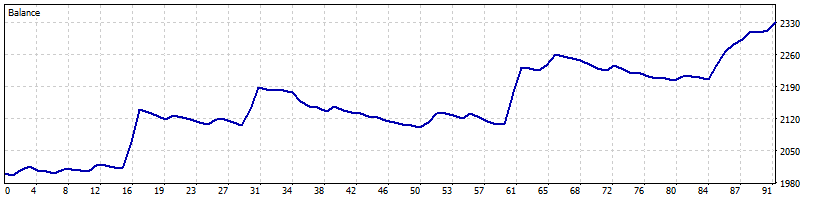

**2025-10** +3.0%

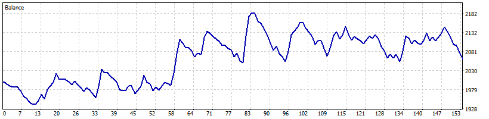

**2025-11** -3.6%

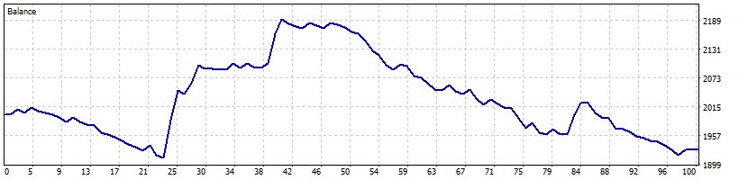

**2025-12** +1.0%

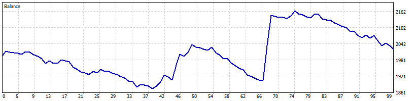

### M5

**2025-01** +3.7%

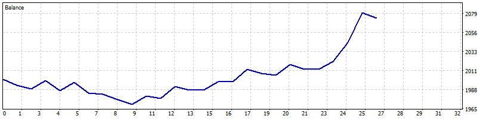

**2025-02** +7.4%

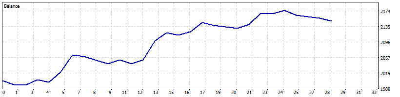

**2025-03** +6.1%

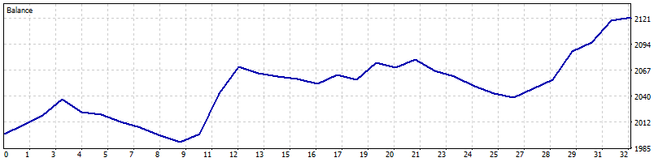

**2025-04** +13.8%

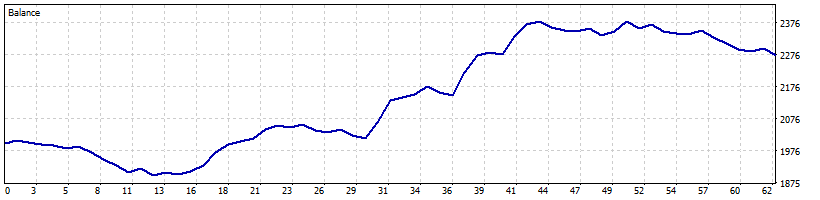

**2025-05** +5.1%

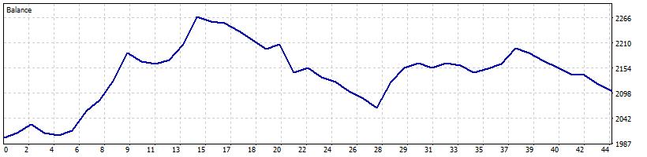

**2025-06** -2.2%

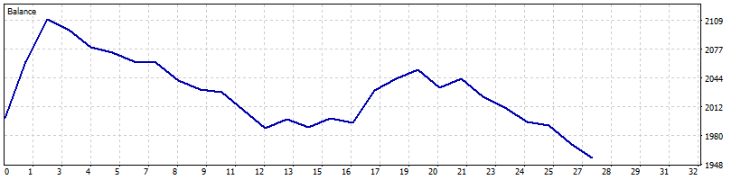

**2025-07** +1.8%

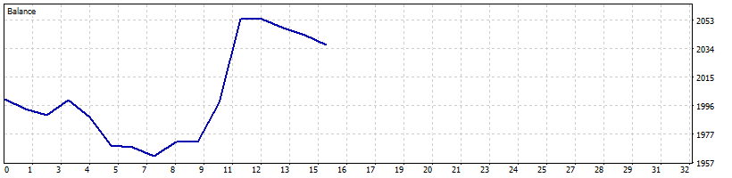

**2025-08** -0.1%

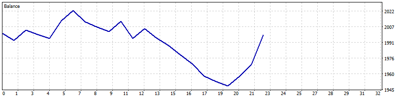

**2025-09** +16.9%

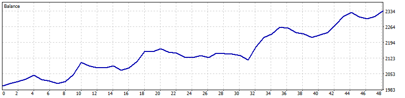

**2025-10** +6.9%

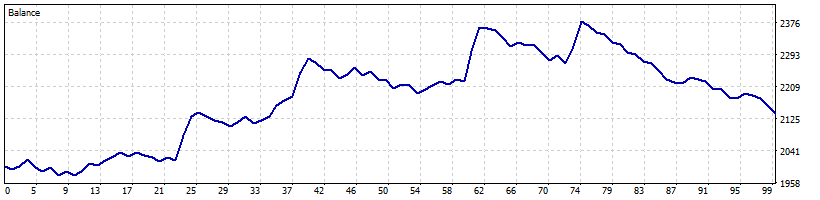

**2025-11** +2.4%

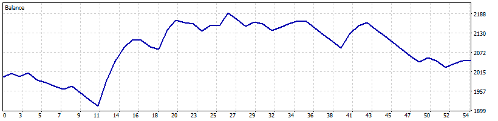

**2025-12** +4.3%

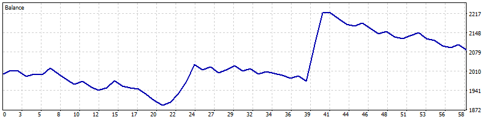
