# Default profile - XAUUSDm M1 vs M5, real ticks Jan-Sep 2026

| Setting | Value |
|---|---|
| EA | Nyao Scalper v48.0 (`nyao_scalper.mq5`) |
| Settings | `settings/default.set` |
| Git commit | 84ebb10 |
| Symbol / timeframes | XAUUSDm / M1, M5 |
| Tick data | Every tick based on real ticks |
| Deposit / leverage | 2,000 USD / 1:500 |
| Runs | One run per month, each starting from a fresh deposit |
| Generated | 2026-10-16 10:03 with `tools/backtest/nyao_backtest.py` |

## Summary

Total return is the sum of the monthly returns (each month starts from the same deposit, not compounded).

| Timeframe | Total return | Profitable | Best / worst run | Max drawdown | Trades | Win rate | Avg win / loss | Profit factor | Tick data |
|---|---|---|---|---|---|---|---|---|---|
| M1 | +8.9% | 5/9 | +27.9% / -20.1% | 27.5% | 1,369 | 35% | $21.13 / -$11.17 | 1.02 | 100% real ticks |
| M5 | +83.3% | 6/9 | +39.9% / -3.1% | 20.0% | 1,112 | 44% | $20.71 / -$13.42 | 1.20 | 100% real ticks |

## Results per run

| Run | M1 | M5 |
|---|---|---|
| 2026-01 | +27.9% (DD 9%, 181 trades) | +39.9% (DD 9%, 166 trades) |
| 2026-02 | -20.1% (DD 27%, 180 trades) | +1.4% (DD 19%, 202 trades) |
| 2026-03 | +10.9% (DD 16%, 279 trades) | +9.9% (DD 19%, 198 trades) |
| 2026-04 | -20.0% (DD 27%, 94 trades) | -2.8% (DD 20%, 84 trades) |
| 2026-05 | -9.5% (DD 18%, 120 trades) | +1.6% (DD 13%, 90 trades) |
| 2026-06 | +20.4% (DD 10%, 192 trades) | +35.8% (DD 8%, 153 trades) |
| 2026-07 | +0.9% (DD 15%, 107 trades) | -3.1% (DD 10%, 66 trades) |
| 2026-08 | -5.4% (DD 14%, 135 trades) | +2.7% (DD 11%, 96 trades) |
| 2026-09 | +3.7% (DD 8%, 81 trades) | -2.0% (DD 12%, 57 trades) |

## Balance graphs

### M1

**2026-01** +27.9%

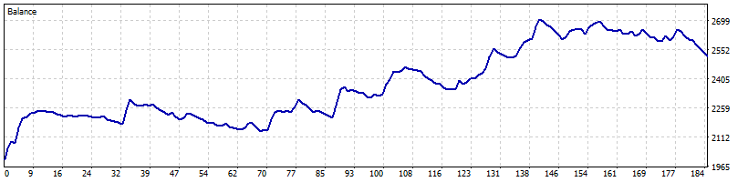

**2026-02** -20.1%

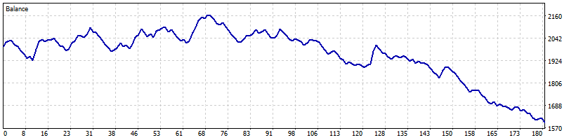

**2026-03** +10.9%

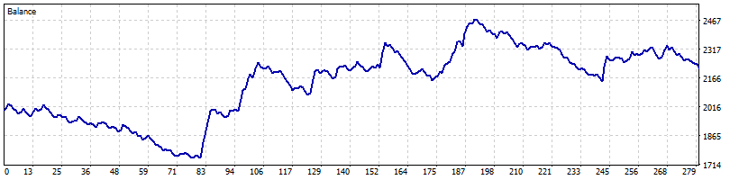

**2026-04** -20.0%

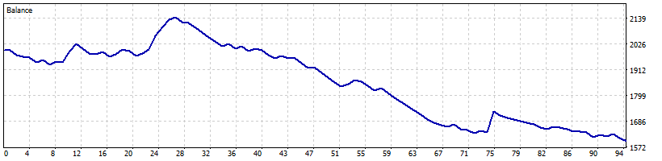

**2026-05** -9.5%

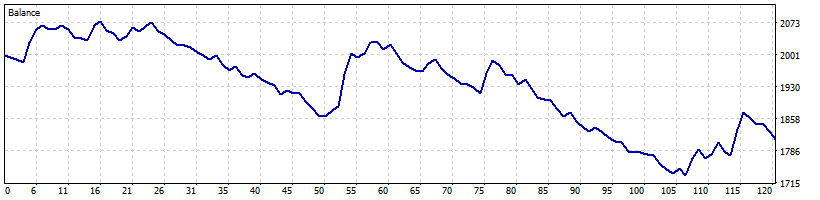

**2026-06** +20.4%

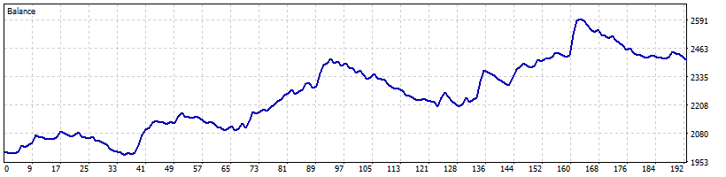

**2026-07** +0.9%

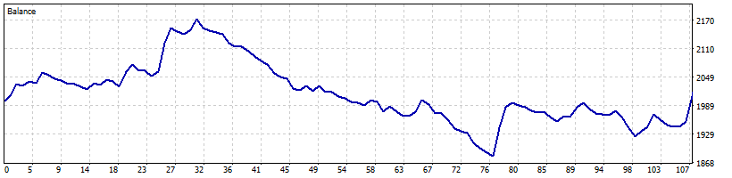

**2026-08** -5.4%

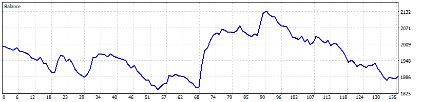

**2026-09** +3.7%

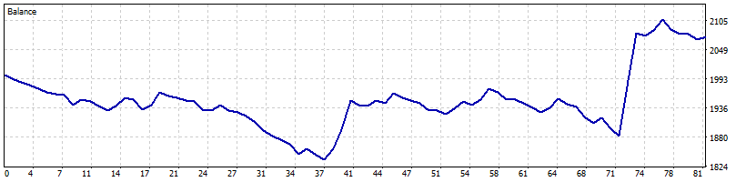

### M5

**2026-01** +39.9%

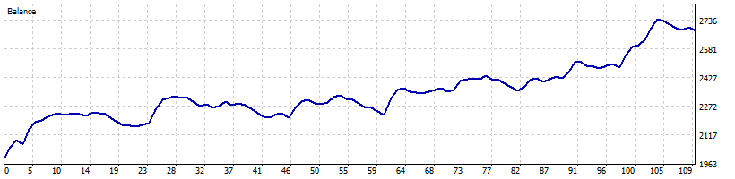

**2026-02** +1.4%

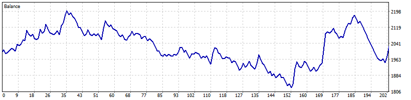

**2026-03** +9.9%

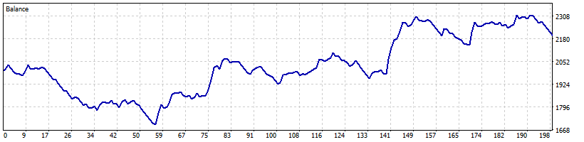

**2026-04** -2.8%

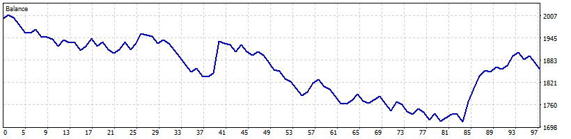

**2026-05** +1.6%

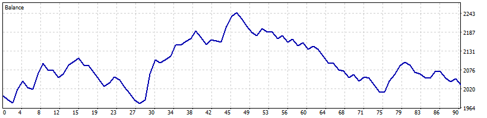

**2026-06** +35.8%

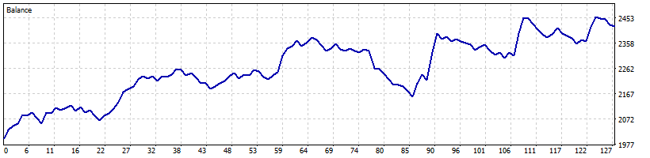

**2026-07** -3.1%

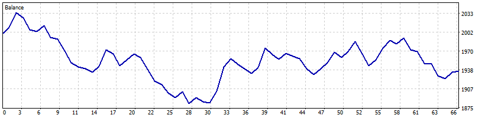

**2026-08** +2.7%

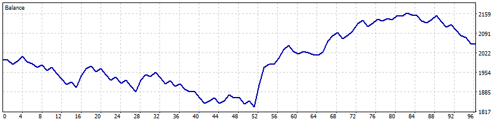

**2026-09** -2.0%

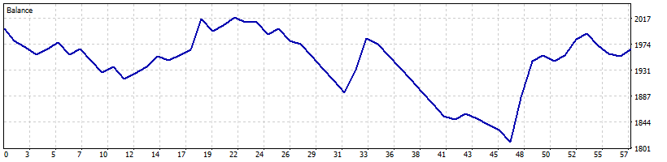
