# Default profile - XAUUSDm M1 vs M5, real ticks Jan-Sep 2026

| Setting | Value |
|---|---|
| EA | Nyao Scalper v53.0 (`nyao_scalper.mq5`) |
| Settings | `settings/default.set` |
| Git commit | 882a821 |
| Symbol / timeframes | XAUUSDm / M1, M5 |
| Tick data | Every tick based on real ticks |
| Deposit / leverage | 2,000 USD / 1:500 |
| Runs | One run per month, each starting from a fresh deposit |
| Generated | 2026-10-22 19:25 with `tools/backtest/nyao_backtest.py` |

## Summary

Total return is the sum of the monthly returns (each month starts from the same deposit, not compounded).

| Timeframe | Total return | Profitable | Best / worst run | Max drawdown | Trades | Win rate | Avg win / loss | Profit factor | Tick data |
|---|---|---|---|---|---|---|---|---|---|
| M1 | +24.0% | 5/9 | +25.9% / -13.5% | 31.4% | 1,494 | 35% | $20.93 / -$10.75 | 1.05 | 100% real ticks |
| M5 | +93.8% | 5/9 | +47.6% / -2.7% | 19.2% | 1,122 | 44% | $20.39 / -$12.84 | 1.23 | 100% real ticks |

## Results per run

| Run | M1 | M5 |
|---|---|---|
| 2026-01 | +25.9% (DD 9%, 185 trades) | +47.6% (DD 9%, 176 trades) |
| 2026-02 | -13.5% (DD 31%, 262 trades) | +5.8% (DD 16%, 202 trades) |
| 2026-03 | +10.8% (DD 15%, 281 trades) | +11.4% (DD 18%, 199 trades) |
| 2026-04 | -10.3% (DD 26%, 131 trades) | -2.0% (DD 19%, 87 trades) |
| 2026-05 | -7.1% (DD 16%, 118 trades) | +2.8% (DD 13%, 91 trades) |
| 2026-06 | +18.4% (DD 10%, 189 trades) | +34.4% (DD 8%, 147 trades) |
| 2026-07 | +1.3% (DD 14%, 109 trades) | -1.7% (DD 8%, 67 trades) |
| 2026-08 | -5.3% (DD 14%, 136 trades) | -2.7% (DD 10%, 96 trades) |
| 2026-09 | +3.8% (DD 8%, 83 trades) | -1.7% (DD 12%, 57 trades) |

## Balance & equity graphs

### M1

**2026-01** +25.9%

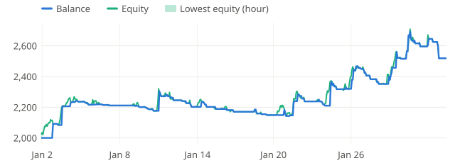

**2026-02** -13.5%

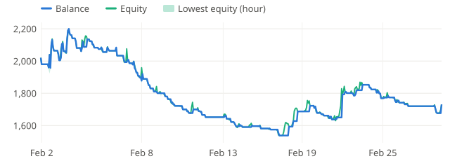

**2026-03** +10.8%

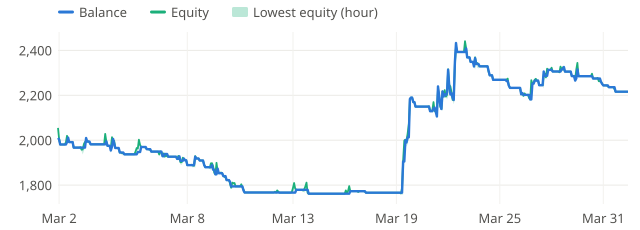

**2026-04** -10.3%

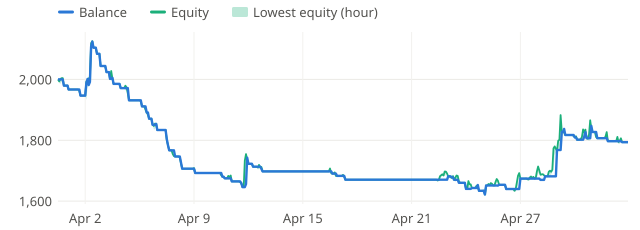

**2026-05** -7.1%

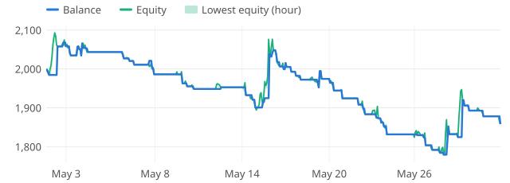

**2026-06** +18.4%

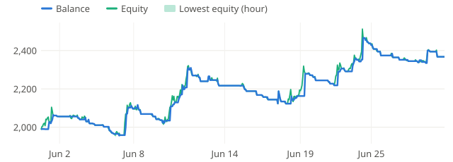

**2026-07** +1.3%

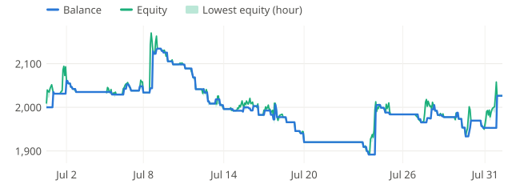

**2026-08** -5.3%

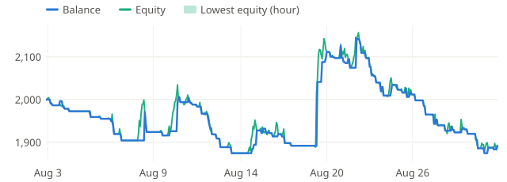

**2026-09** +3.8%

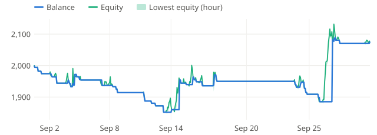

### M5

**2026-01** +47.6%

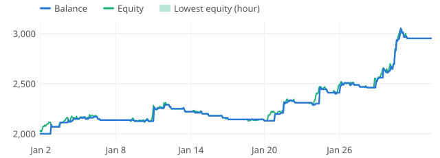

**2026-02** +5.8%

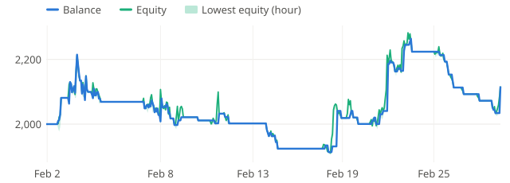

**2026-03** +11.4%

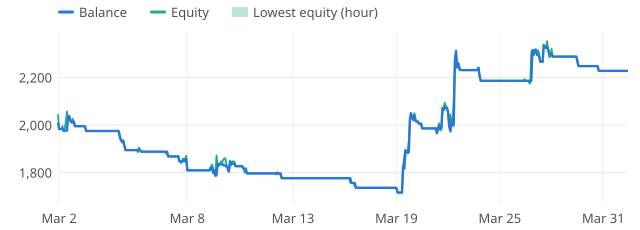

**2026-04** -2.0%

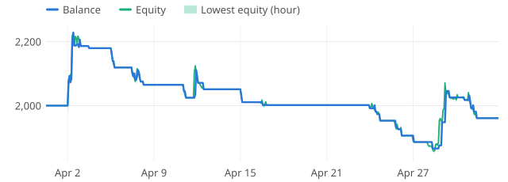

**2026-05** +2.8%

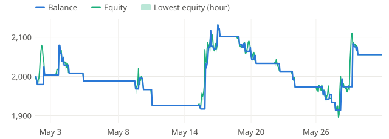

**2026-06** +34.4%

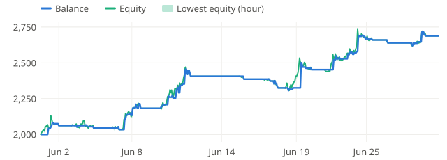

**2026-07** -1.7%

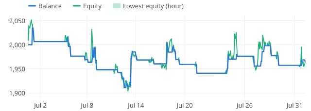

**2026-08** -2.7%

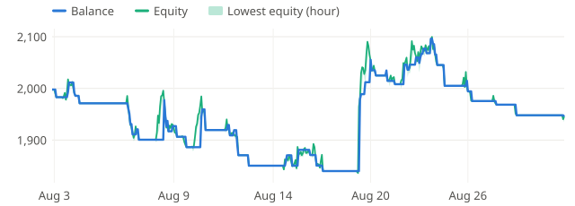

**2026-09** -1.7%

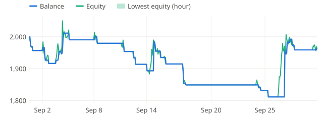
