# High-risk profile - XAUUSDm M1 vs M5, Jan-Dec 2025

| Setting | Value |
|---|---|
| EA | Nyao Scalper v50.0 (`nyao_scalper.mq5`) |
| Settings | `settings/high-risk.set` |
| Git commit | 5894cd7 |
| Symbol / timeframes | XAUUSDm / M1, M5 |
| Tick data | Generated from 1-minute bars (no real tick history for this period) |
| Deposit / leverage | 2,000 USD / 1:500 |
| Runs | One run per month, each starting from a fresh deposit |
| Generated | 2026-10-16 21:16 with `tools/backtest/nyao_backtest.py` |

## Summary

Total return is the sum of the monthly returns (each month starts from the same deposit, not compounded).

| Timeframe | Total return | Profitable | Best / worst run | Max drawdown | Trades | Win rate | Avg win / loss | Profit factor | Tick data |
|---|---|---|---|---|---|---|---|---|---|
| M1 | +78.3% | 9/12 | +29.6% / -8.8% | 23.6% | 812 | 26% | $45.82 / -$13.28 | 1.20 | 0% real ticks |
| M5 | +97.4% | 11/12 | +20.9% / -0.6% | 26.4% | 461 | 44% | $45.87 / -$27.97 | 1.27 | 0% real ticks |

## Results per run

| Run | M1 | M5 |
|---|---|---|
| 2025-01 | +1.7% (DD 5%, 42 trades) | +7.2% (DD 7%, 23 trades) |
| 2025-02 | +7.8% (DD 11%, 44 trades) | +8.7% (DD 7%, 24 trades) |
| 2025-03 | -8.8% (DD 11%, 57 trades) | +13.7% (DD 9%, 26 trades) |
| 2025-04 | +23.1% (DD 18%, 85 trades) | +16.7% (DD 18%, 54 trades) |
| 2025-05 | +11.5% (DD 10%, 76 trades) | +10.4% (DD 21%, 41 trades) |
| 2025-06 | +3.2% (DD 12%, 53 trades) | +0.9% (DD 12%, 23 trades) |
| 2025-07 | +6.9% (DD 6%, 24 trades) | -0.6% (DD 9%, 15 trades) |
| 2025-08 | -1.1% (DD 8%, 28 trades) | +0.9% (DD 8%, 15 trades) |
| 2025-09 | +29.6% (DD 11%, 74 trades) | +20.9% (DD 11%, 41 trades) |
| 2025-10 | +5.9% (DD 12%, 143 trades) | +6.5% (DD 26%, 95 trades) |
| 2025-11 | -6.0% (DD 24%, 92 trades) | +0.8% (DD 16%, 51 trades) |
| 2025-12 | +4.5% (DD 19%, 94 trades) | +11.4% (DD 15%, 53 trades) |

## Balance graphs

### M1

**2025-01** +1.7%

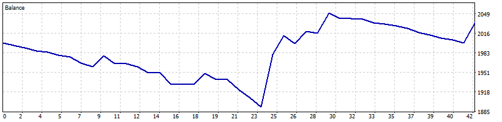

**2025-02** +7.8%

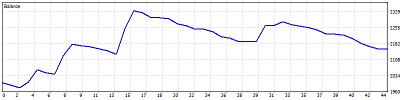

**2025-03** -8.8%

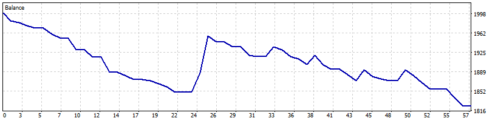

**2025-04** +23.1%

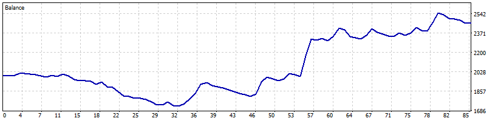

**2025-05** +11.5%

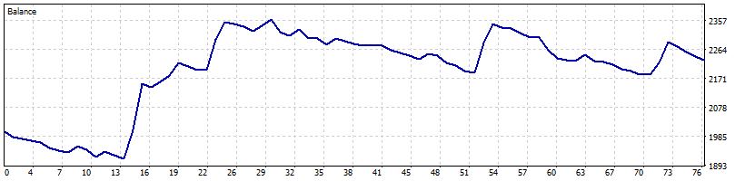

**2025-06** +3.2%

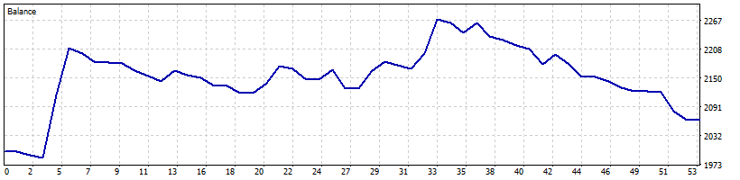

**2025-07** +6.9%

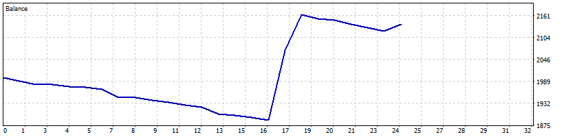

**2025-08** -1.1%

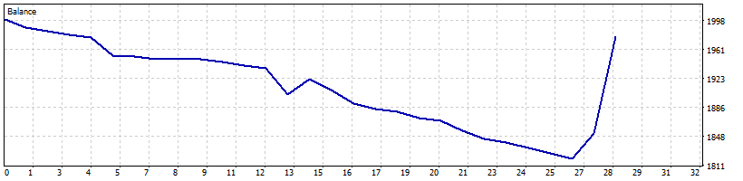

**2025-09** +29.6%

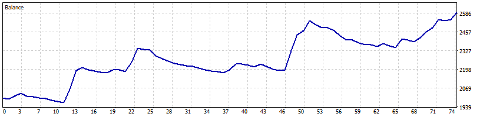

**2025-10** +5.9%

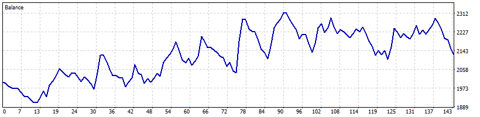

**2025-11** -6.0%

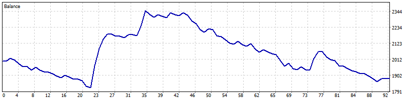

**2025-12** +4.5%

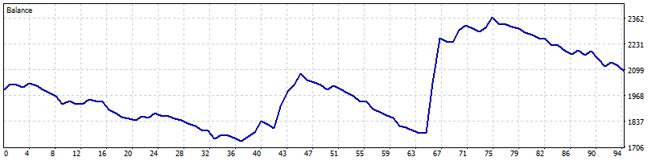

### M5

**2025-01** +7.2%

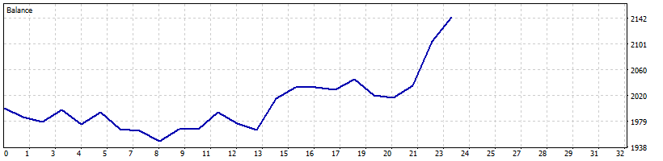

**2025-02** +8.7%

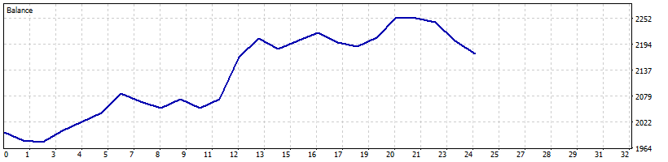

**2025-03** +13.7%

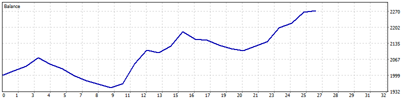

**2025-04** +16.7%

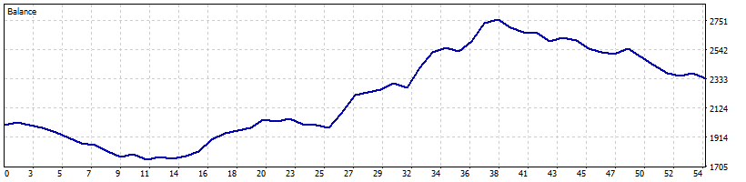

**2025-05** +10.4%

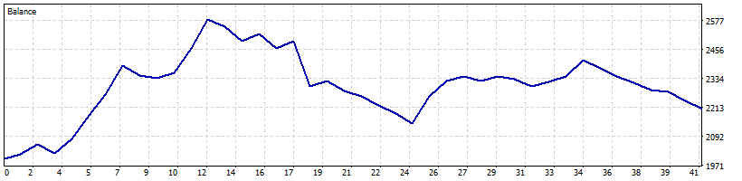

**2025-06** +0.9%

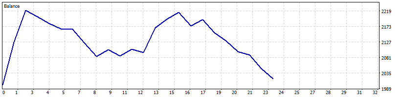

**2025-07** -0.6%

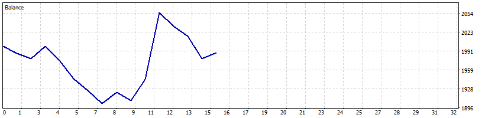

**2025-08** +0.9%

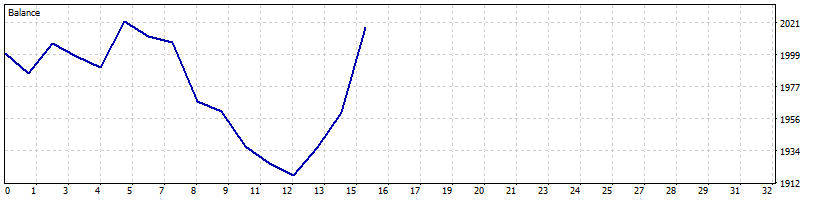

**2025-09** +20.9%

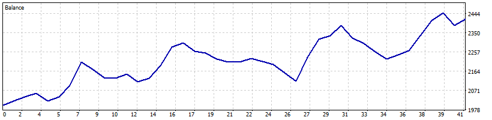

**2025-10** +6.5%

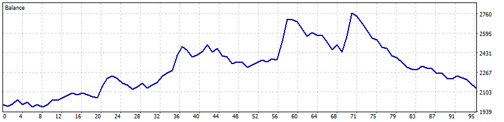

**2025-11** +0.8%

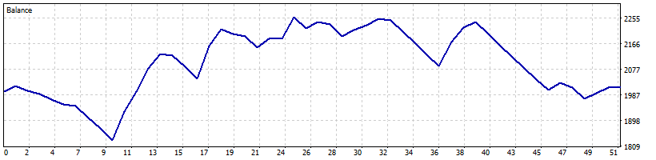

**2025-12** +11.4%

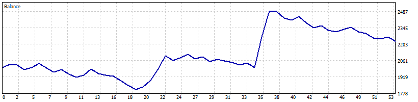
