# High-risk profile - XAUUSDm M1 vs M5, real ticks Jan-Sep 2026

| Setting | Value |
|---|---|
| EA | Nyao Scalper v50.0 (`nyao_scalper.mq5`) |
| Settings | `settings/high-risk.set` |
| Git commit | 5894cd7 |
| Symbol / timeframes | XAUUSDm / M1, M5 |
| Tick data | Every tick based on real ticks |
| Deposit / leverage | 2,000 USD / 1:500 |
| Runs | One run per month, each starting from a fresh deposit |
| Generated | 2026-10-16 21:09 with `tools/backtest/nyao_backtest.py` |

## Summary

Total return is the sum of the monthly returns (each month starts from the same deposit, not compounded).

| Timeframe | Total return | Profitable | Best / worst run | Max drawdown | Trades | Win rate | Avg win / loss | Profit factor | Tick data |
|---|---|---|---|---|---|---|---|---|---|
| M1 | +4.0% | 5/9 | +53.7% / -27.0% | 46.3% | 1,416 | 36% | $42.84 / -$23.95 | 1.00 | 100% real ticks |
| M5 | +176.4% | 5/9 | +101.7% / -16.1% | 36.3% | 1,068 | 44% | $46.56 / -$30.30 | 1.19 | 100% real ticks |

## Results per run

| Run | M1 | M5 |
|---|---|---|
| 2026-01 | +53.7% (DD 20%, 172 trades) | +101.7% (DD 16%, 152 trades) |
| 2026-02 | -27.0% (DD 46%, 259 trades) | -14.3% (DD 35%, 189 trades) |
| 2026-03 | +8.7% (DD 32%, 278 trades) | +7.7% (DD 33%, 201 trades) |
| 2026-04 | -23.8% (DD 41%, 131 trades) | -16.1% (DD 36%, 84 trades) |
| 2026-05 | -22.0% (DD 33%, 118 trades) | +2.3% (DD 21%, 89 trades) |
| 2026-06 | +13.2% (DD 24%, 165 trades) | +96.7% (DD 20%, 141 trades) |
| 2026-07 | +5.1% (DD 24%, 98 trades) | -4.3% (DD 17%, 65 trades) |
| 2026-08 | -6.0% (DD 22%, 120 trades) | +4.0% (DD 19%, 92 trades) |
| 2026-09 | +2.1% (DD 17%, 75 trades) | -1.2% (DD 23%, 55 trades) |

## Balance graphs

### M1

**2026-01** +53.7%

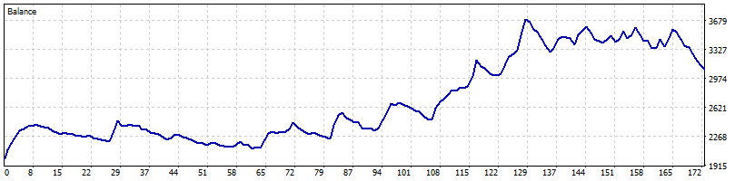

**2026-02** -27.0%

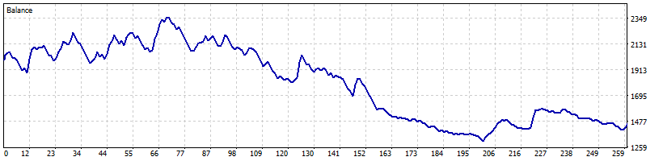

**2026-03** +8.7%

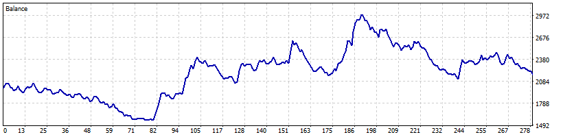

**2026-04** -23.8%

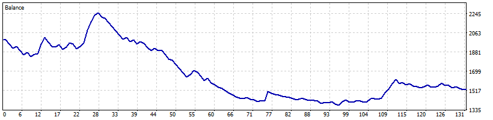

**2026-05** -22.0%

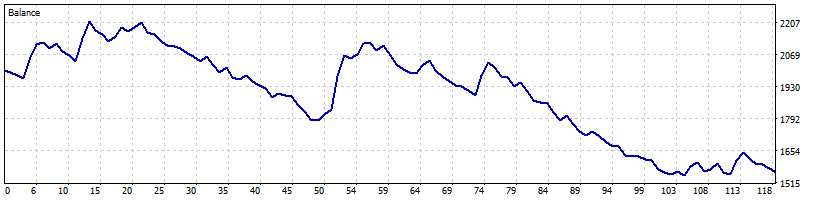

**2026-06** +13.2%

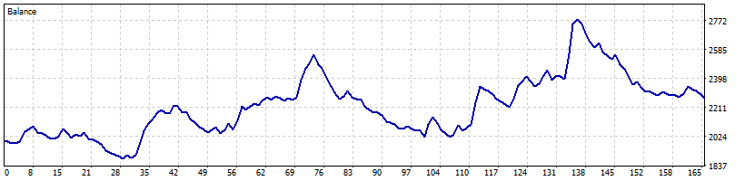

**2026-07** +5.1%

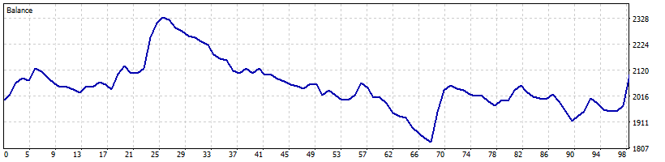

**2026-08** -6.0%

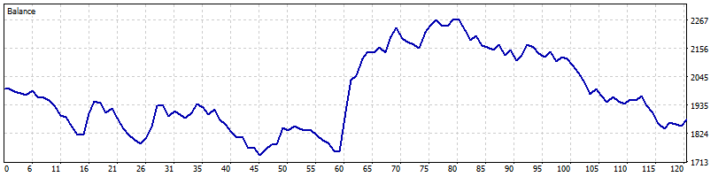

**2026-09** +2.1%

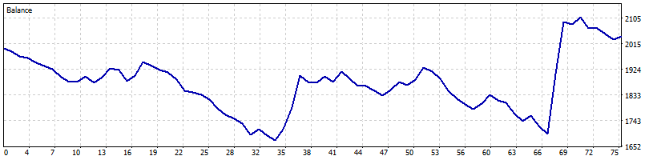

### M5

**2026-01** +101.7%

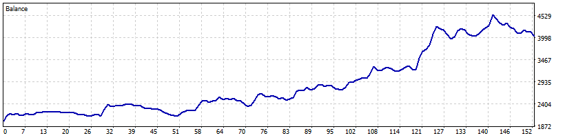

**2026-02** -14.3%

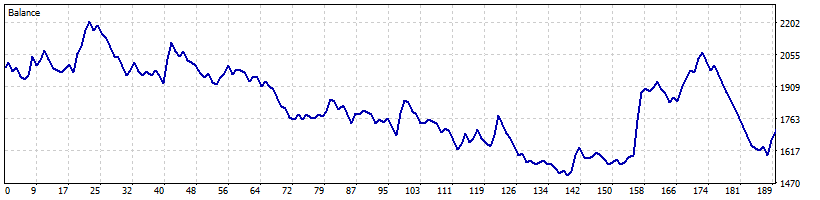

**2026-03** +7.7%

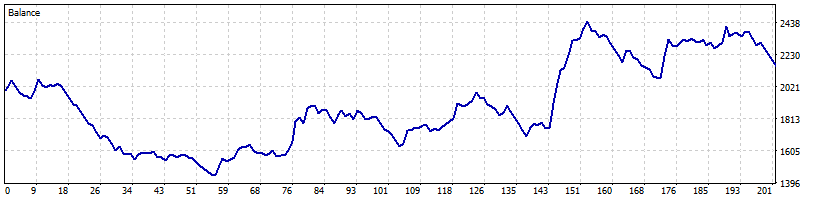

**2026-04** -16.1%

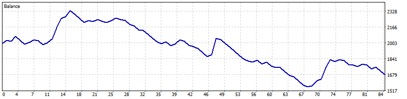

**2026-05** +2.3%

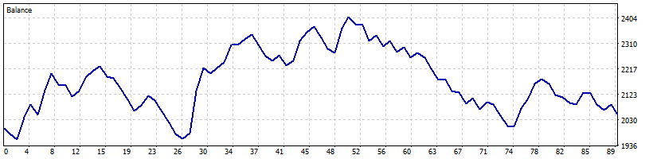

**2026-06** +96.7%

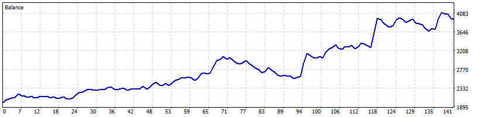

**2026-07** -4.3%

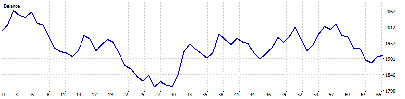

**2026-08** +4.0%

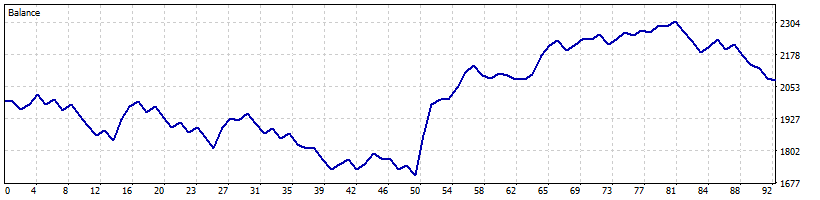

**2026-09** -1.2%

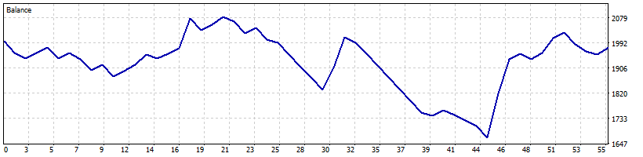
