# USDJPY profile - USDJPYm M5, generated ticks 2022-2024

| Setting | Value |
|---|---|
| EA | Nyao Scalper v54.0 (`nyao_scalper.mq5`) |
| Settings | `settings/usdjpy-default.set` |
| Git commit | 66a89db |
| Symbol / timeframes | USDJPYm / M5 |
| Tick data | Every tick (generated) |
| Deposit / leverage | 2,000 USD / 1:500 |
| Runs | One run per month, each starting from a fresh deposit |
| Generated | 2026-10-26 03:36 with `tools/backtest/nyao_backtest.py` |

## Summary

Total return is the sum of the monthly returns (each month starts from the same deposit, not compounded).

| Timeframe | Total return | Profitable | Best / worst run | Max drawdown | Trades | Win rate | Avg win / loss | Profit factor | Tick data |
|---|---|---|---|---|---|---|---|---|---|
| M5 | +96.0% | 18/36 | +19.5% / -6.9% | 10.8% | 889 | 34% | $22.21 / -$8.16 | 1.40 | 100% |

## Results per run

| Run | M5 |
|---|---|
| 2022-01 | -0.9% (DD 3%, 12 trades) |
| 2022-02 | -0.5% (DD 2%, 9 trades) |
| 2022-03 | +14.1% (DD 5%, 19 trades) |
| 2022-04 | +15.3% (DD 4%, 20 trades) |
| 2022-05 | -3.7% (DD 5%, 19 trades) |
| 2022-06 | +9.4% (DD 7%, 29 trades) |
| 2022-07 | -1.3% (DD 5%, 27 trades) |
| 2022-08 | +4.6% (DD 5%, 22 trades) |
| 2022-09 | +1.5% (DD 9%, 38 trades) |
| 2022-10 | +13.5% (DD 6%, 21 trades) |
| 2022-11 | -1.6% (DD 7%, 33 trades) |
| 2022-12 | +5.4% (DD 6%, 33 trades) |
| 2023-01 | -1.9% (DD 9%, 32 trades) |
| 2023-02 | -2.0% (DD 5%, 26 trades) |
| 2023-03 | -6.9% (DD 8%, 30 trades) |
| 2023-04 | -1.2% (DD 7%, 16 trades) |
| 2023-05 | +1.3% (DD 5%, 24 trades) |
| 2023-06 | -0.7% (DD 5%, 32 trades) |
| 2023-07 | -2.3% (DD 4%, 18 trades) |
| 2023-08 | +0.5% (DD 4%, 31 trades) |
| 2023-09 | +4.0% (DD 4%, 19 trades) |
| 2023-10 | -1.0% (DD 4%, 15 trades) |
| 2023-11 | -1.9% (DD 3%, 23 trades) |
| 2023-12 | +13.5% (DD 5%, 31 trades) |
| 2024-01 | -0.5% (DD 3%, 12 trades) |
| 2024-02 | -0.7% (DD 2%, 14 trades) |
| 2024-03 | -0.5% (DD 3%, 17 trades) |
| 2024-04 | +19.5% (DD 3%, 14 trades) |
| 2024-05 | +3.0% (DD 3%, 29 trades) |
| 2024-06 | -1.9% (DD 6%, 23 trades) |
| 2024-07 | +17.2% (DD 5%, 32 trades) |
| 2024-08 | +0.9% (DD 11%, 43 trades) |
| 2024-09 | -1.4% (DD 8%, 38 trades) |
| 2024-10 | +1.0% (DD 3%, 30 trades) |
| 2024-11 | +0.7% (DD 4%, 31 trades) |
| 2024-12 | +1.8% (DD 5%, 27 trades) |

## Balance & equity graphs

### M5

**2022-01** -0.9%

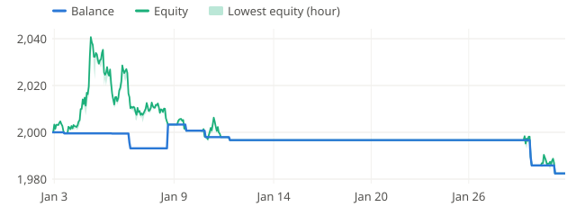

**2022-02** -0.5%

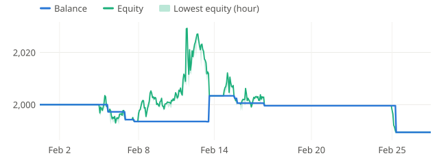

**2022-03** +14.1%

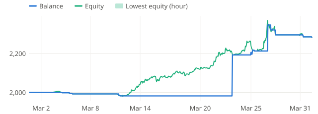

**2022-04** +15.3%

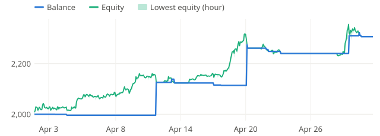

**2022-05** -3.7%

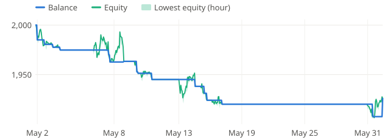

**2022-06** +9.4%

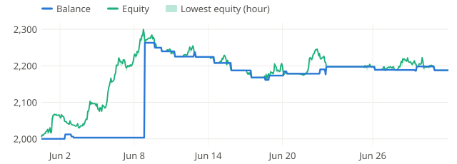

**2022-07** -1.3%

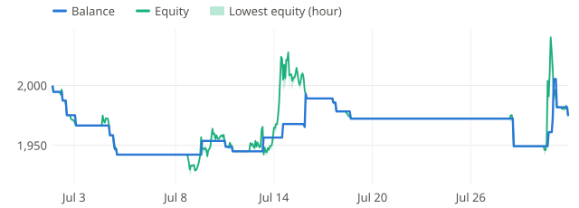

**2022-08** +4.6%

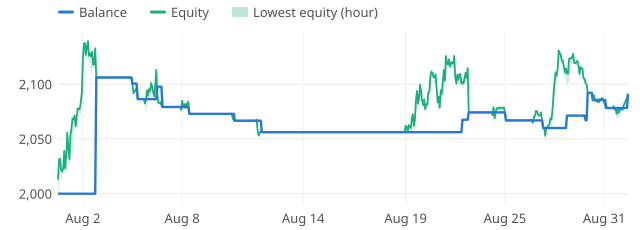

**2022-09** +1.5%

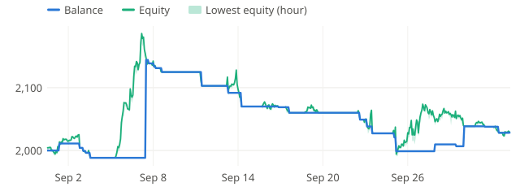

**2022-10** +13.5%

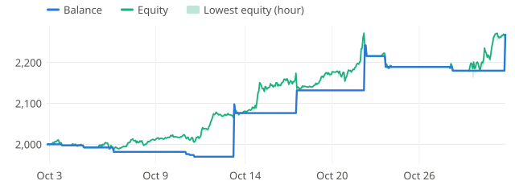

**2022-11** -1.6%

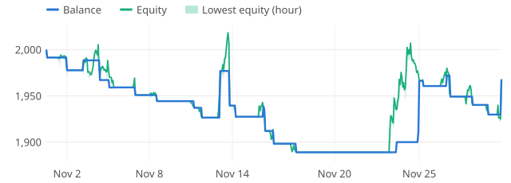

**2022-12** +5.4%

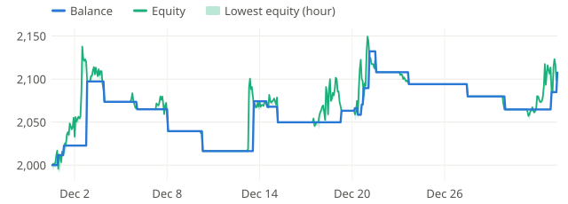

**2023-01** -1.9%

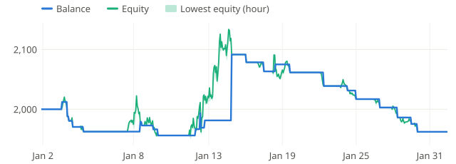

**2023-02** -2.0%

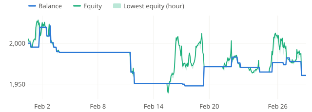

**2023-03** -6.9%

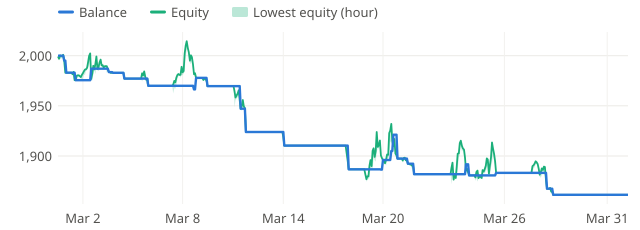

**2023-04** -1.2%

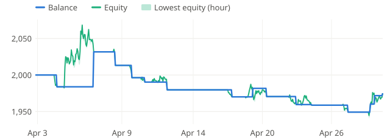

**2023-05** +1.3%

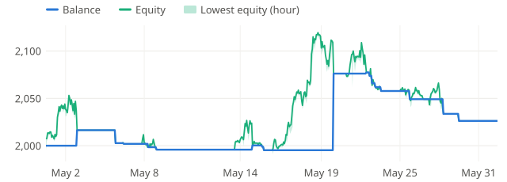

**2023-06** -0.7%

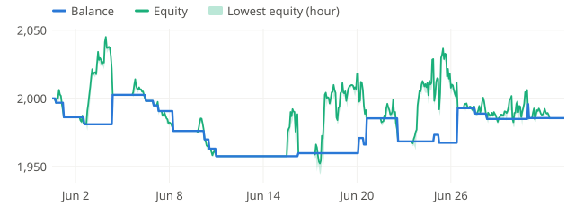

**2023-07** -2.3%

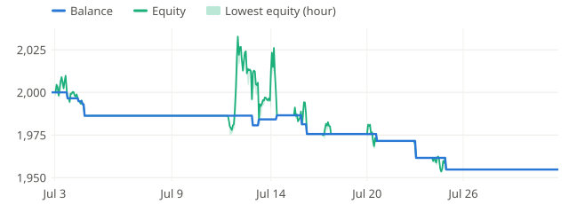

**2023-08** +0.5%

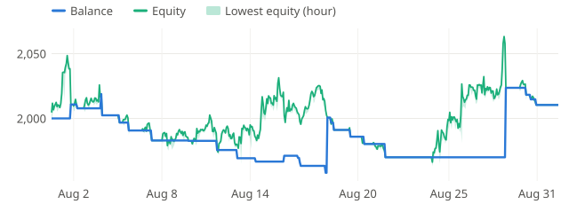

**2023-09** +4.0%

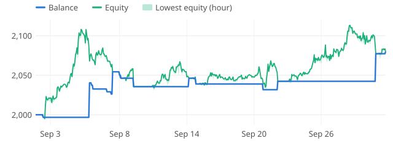

**2023-10** -1.0%

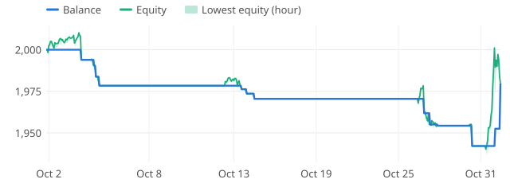

**2023-11** -1.9%

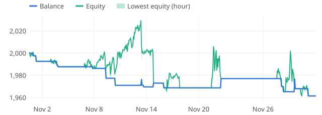

**2023-12** +13.5%

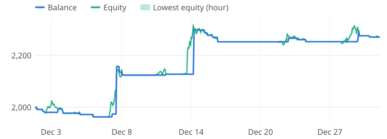

**2024-01** -0.5%

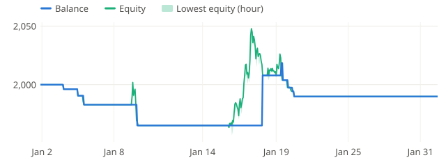

**2024-02** -0.7%

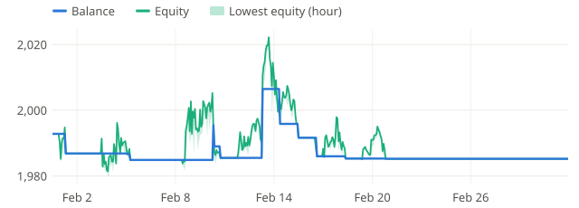

**2024-03** -0.5%

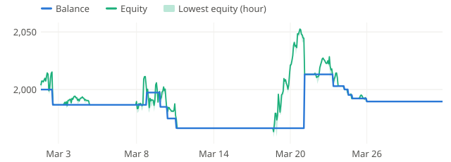

**2024-04** +19.5%

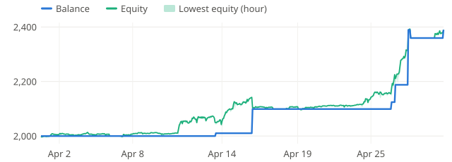

**2024-05** +3.0%

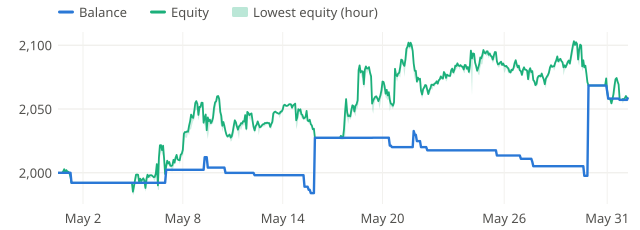

**2024-06** -1.9%

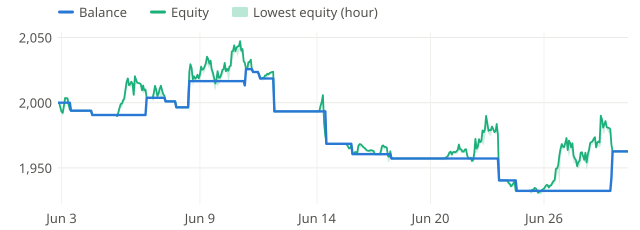

**2024-07** +17.2%

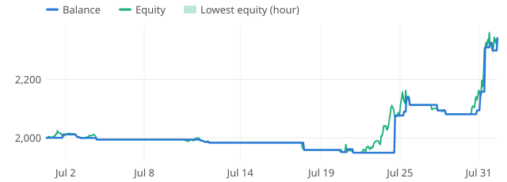

**2024-08** +0.9%

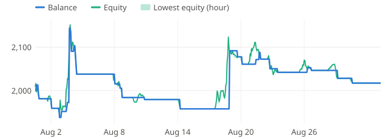

**2024-09** -1.4%

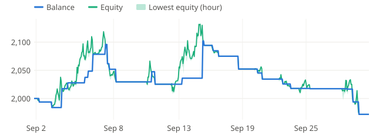

**2024-10** +1.0%

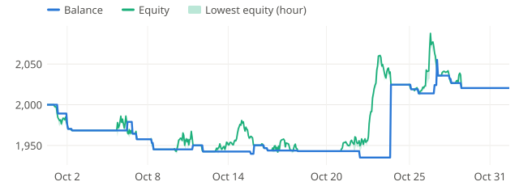

**2024-11** +0.7%

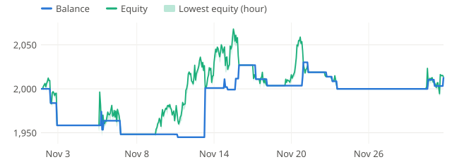

**2024-12** +1.8%

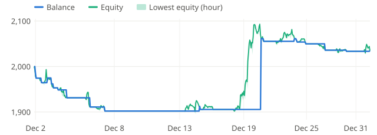
