# USDJPY profile - USDJPYm M5, generated ticks 2025

| Setting | Value |
|---|---|
| EA | Nyao Scalper v54.0 (`nyao_scalper.mq5`) |
| Settings | `settings/usdjpy-default.set` |
| Git commit | b7b5881 |
| Symbol / timeframes | USDJPYm / M5 |
| Tick data | Every tick (generated) |
| Deposit / leverage | 2,000 USD / 1:500 |
| Runs | One run per month, each starting from a fresh deposit |
| Generated | 2026-10-26 02:04 with `tools/backtest/nyao_backtest.py` |

## Summary

Total return is the sum of the monthly returns (each month starts from the same deposit, not compounded).

| Timeframe | Total return | Profitable | Best / worst run | Max drawdown | Trades | Win rate | Avg win / loss | Profit factor | Tick data |
|---|---|---|---|---|---|---|---|---|---|
| M5 | -6.8% | 5/12 | +3.7% / -4.3% | 9.1% | 262 | 30% | $17.18 / -$8.16 | 0.91 | 100% |

## Results per run

| Run | M5 |
|---|---|
| 2025-01 | -3.3% (DD 4%, 10 trades) |
| 2025-02 | +2.3% (DD 6%, 23 trades) |
| 2025-03 | -1.9% (DD 6%, 22 trades) |
| 2025-04 | -0.3% (DD 9%, 53 trades) |
| 2025-05 | -3.2% (DD 6%, 23 trades) |
| 2025-06 | +2.4% (DD 5%, 18 trades) |
| 2025-07 | +0.2% (DD 5%, 26 trades) |
| 2025-08 | -4.3% (DD 4%, 12 trades) |
| 2025-09 | -3.1% (DD 4%, 10 trades) |
| 2025-10 | +3.7% (DD 6%, 26 trades) |
| 2025-11 | +1.3% (DD 3%, 20 trades) |
| 2025-12 | -0.5% (DD 4%, 19 trades) |

## Balance & equity graphs

### M5

**2025-01** -3.3%

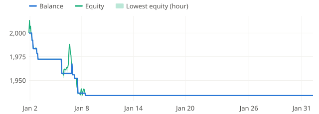

**2025-02** +2.3%

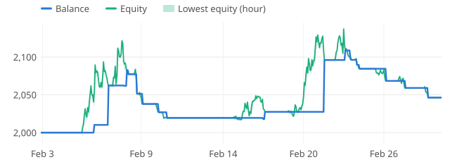

**2025-03** -1.9%

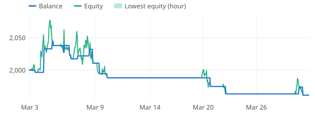

**2025-04** -0.3%

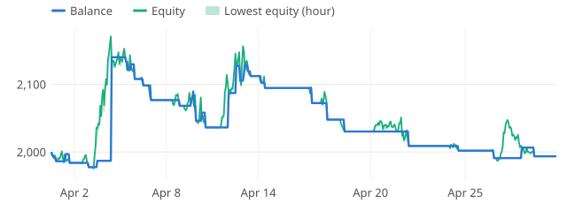

**2025-05** -3.2%

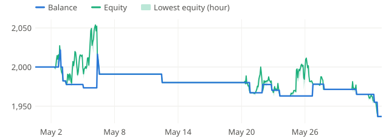

**2025-06** +2.4%

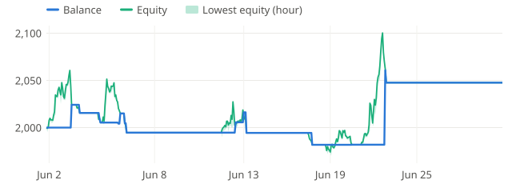

**2025-07** +0.2%

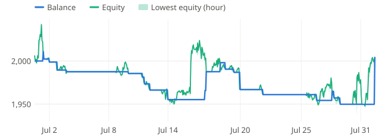

**2025-08** -4.3%

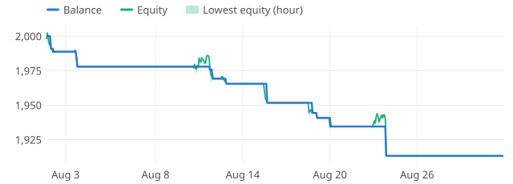

**2025-09** -3.1%

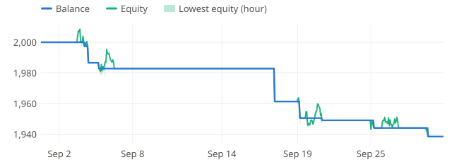

**2025-10** +3.7%

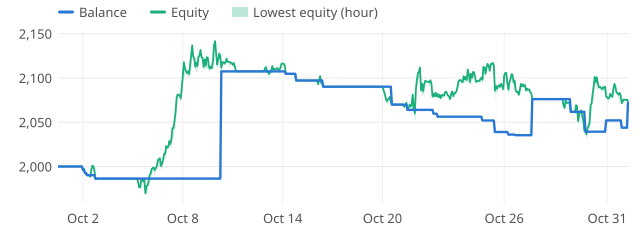

**2025-11** +1.3%

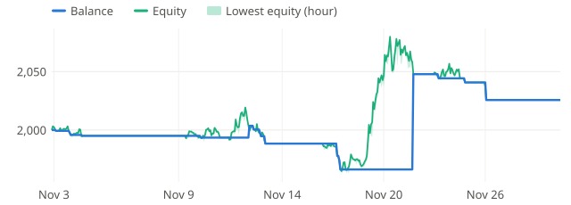

**2025-12** -0.5%

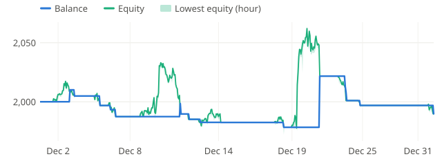
