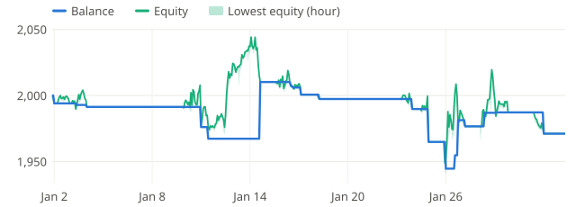
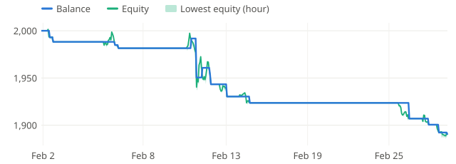
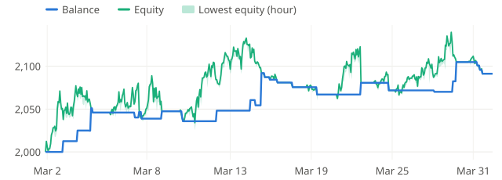
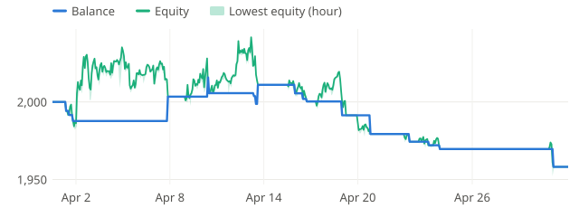
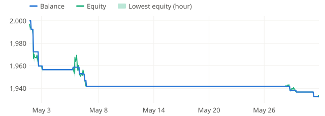
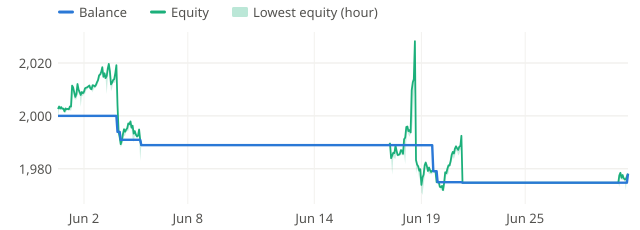
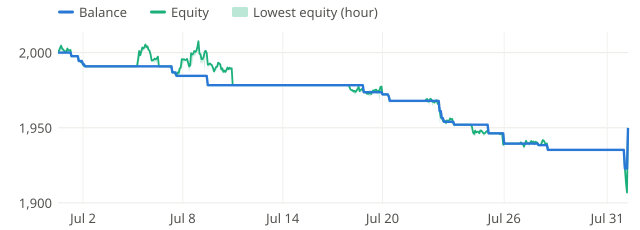
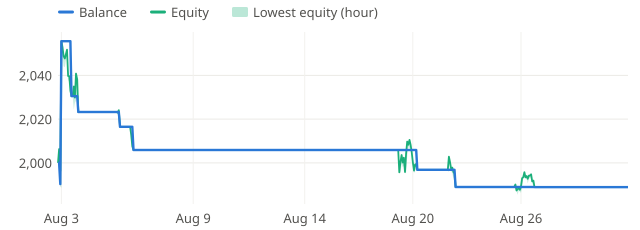
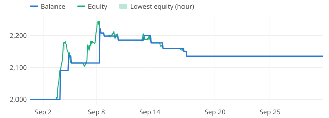

# USDJPY profile - USDJPYm M5, real ticks Jan-Sep 2026

| Setting | Value |
|---|---|
| EA | Nyao Scalper v54.0 (`nyao_scalper.mq5`) |
| Settings | `settings/usdjpy-default.set` |
| Git commit | b7b5881 |
| Symbol / timeframes | USDJPYm / M5 |
| Tick data | Every tick based on real ticks |
| Deposit / leverage | 2,000 USD / 1:500 |
| Runs | One run per month, each starting from a fresh deposit |
| Generated | 2026-10-26 02:02 with `tools/backtest/nyao_backtest.py` |

## Summary

Total return is the sum of the monthly returns (each month starts from the same deposit, not compounded).

| Timeframe | Total return | Profitable | Best / worst run | Max drawdown | Trades | Win rate | Avg win / loss | Profit factor | Tick data |
|---|---|---|---|---|---|---|---|---|---|
| M5 | -5.2% | 2/9 | +6.7% / -5.5% | 6.2% | 168 | 26% | $16.41 / -$6.67 | 0.87 | 100% real ticks |

## Results per run

| Run | M5 |
|---|---|
| 2026-01 | -1.4% (DD 5%, 25 trades) |
| 2026-02 | -5.5% (DD 6%, 16 trades) |
| 2026-03 | +4.6% (DD 4%, 31 trades) |
| 2026-04 | -2.1% (DD 4%, 20 trades) |
| 2026-05 | -3.4% (DD 3%, 14 trades) |
| 2026-06 | -1.1% (DD 3%, 11 trades) |
| 2026-07 | -2.5% (DD 5%, 23 trades) |
| 2026-08 | -0.6% (DD 6%, 11 trades) |
| 2026-09 | +6.7% (DD 6%, 17 trades) |

## Balance & equity graphs

### M5

**2026-01** -1.4%

**2026-02** -5.5%

**2026-03** +4.6%

**2026-04** -2.1%

**2026-05** -3.4%

**2026-06** -1.1%

**2026-07** -2.5%

**2026-08** -0.6%

**2026-09** +6.7%

