# Default profile - XAUUSDm M5, generated ticks 2022-2024

| Setting | Value |
|---|---|
| EA | Nyao Scalper v54.0 (`nyao_scalper.mq5`) |
| Settings | `settings/xauusd-default.set` |
| Git commit | 66a89db |
| Symbol / timeframes | XAUUSDm / M5 |
| Tick data | Every tick (generated) |
| Deposit / leverage | 2,000 USD / 1:500 |
| Runs | One run per month, each starting from a fresh deposit |
| Generated | 2026-10-26 03:21 with `tools/backtest/nyao_backtest.py` |

## Summary

Total return is the sum of the monthly returns (each month starts from the same deposit, not compounded).

| Timeframe | Total return | Profitable | Best / worst run | Max drawdown | Trades | Win rate | Avg win / loss | Profit factor | Tick data |
|---|---|---|---|---|---|---|---|---|---|
| M5 | -13.4% | 12/36 | +13.7% / -6.5% | 9.2% | 707 | 21% | $19.81 / -$5.77 | 0.92 | 100%, 92%, 96% |

## Results per run

| Run | M5 |
|---|---|
| 2022-01 | -1.9% (DD 2%, 9 trades) |
| 2022-02 | +4.3% (DD 5%, 19 trades) |
| 2022-03 | +1.8% (DD 6%, 35 trades) |
| 2022-04 | -1.4% (DD 3%, 17 trades) |
| 2022-05 | +2.5% (DD 4%, 20 trades) |
| 2022-06 | -3.6% (DD 4%, 13 trades) |
| 2022-07 | -0.0% (DD 4%, 28 trades) |
| 2022-08 | -1.0% (DD 3%, 13 trades) |
| 2022-09 | -0.3% (DD 3%, 18 trades) |
| 2022-10 | -3.0% (DD 4%, 18 trades) |
| 2022-11 | +0.1% (DD 4%, 26 trades) |
| 2022-12 | -2.8% (DD 6%, 22 trades) |
| 2023-01 | -3.5% (DD 5%, 27 trades) |
| 2023-02 | -3.2% (DD 5%, 15 trades) |
| 2023-03 | +0.1% (DD 5%, 27 trades) |
| 2023-04 | -3.4% (DD 7%, 23 trades) |
| 2023-05 | +0.8% (DD 6%, 19 trades) |
| 2023-06 | -1.0% (DD 3%, 18 trades) |
| 2023-07 | -1.8% (DD 2%, 12 trades) |
| 2023-08 | -1.4% (DD 1%, 12 trades) |
| 2023-09 | +1.5% (DD 2%, 8 trades) |
| 2023-10 | -0.1% (DD 4%, 20 trades) |
| 2023-11 | -0.1% (DD 2%, 20 trades) |
| 2023-12 | +3.2% (DD 6%, 12 trades) |
| 2024-01 | -2.5% (DD 3%, 12 trades) |
| 2024-02 | -0.2% (DD 2%, 6 trades) |
| 2024-03 | +13.7% (DD 4%, 21 trades) |
| 2024-04 | -4.3% (DD 9%, 39 trades) |
| 2024-05 | -0.2% (DD 5%, 29 trades) |
| 2024-06 | -3.1% (DD 4%, 8 trades) |
| 2024-07 | +2.0% (DD 4%, 27 trades) |
| 2024-08 | -6.5% (DD 8%, 31 trades) |
| 2024-09 | +4.0% (DD 5%, 28 trades) |
| 2024-10 | +3.8% (DD 4%, 25 trades) |
| 2024-11 | -0.8% (DD 5%, 19 trades) |
| 2024-12 | -4.9% (DD 6%, 11 trades) |

## Balance & equity graphs

### M5

**2022-01** -1.9%

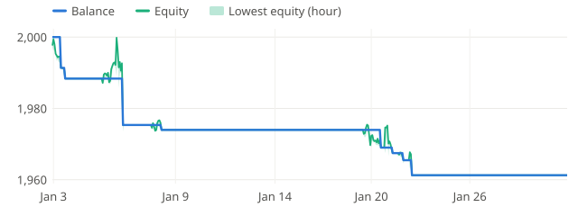

**2022-02** +4.3%

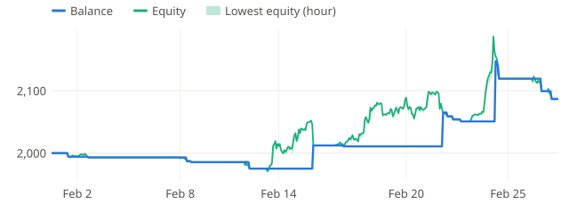

**2022-03** +1.8%

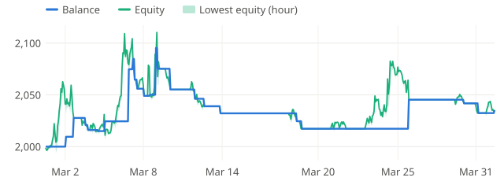

**2022-04** -1.4%

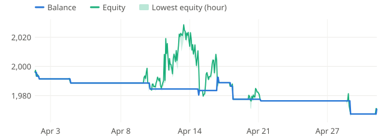

**2022-05** +2.5%

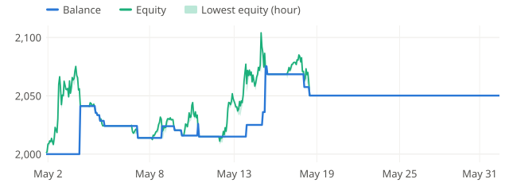

**2022-06** -3.6%

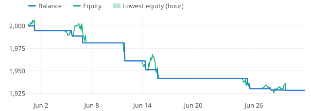

**2022-07** -0.0%

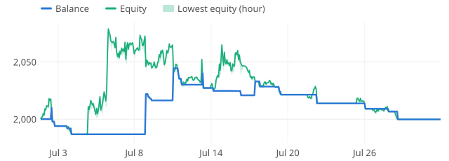

**2022-08** -1.0%

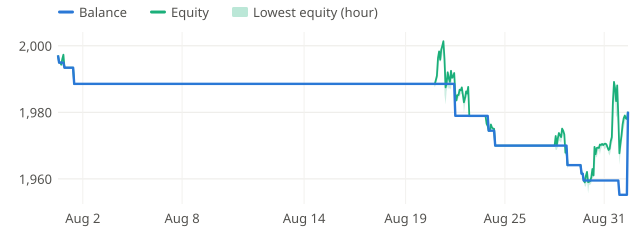

**2022-09** -0.3%

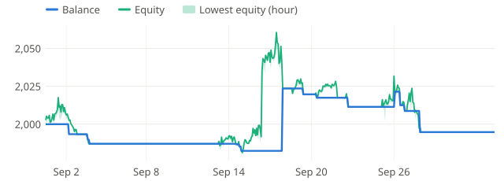

**2022-10** -3.0%

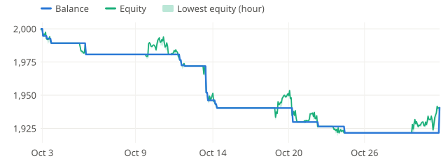

**2022-11** +0.1%

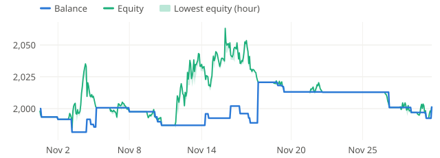

**2022-12** -2.8%

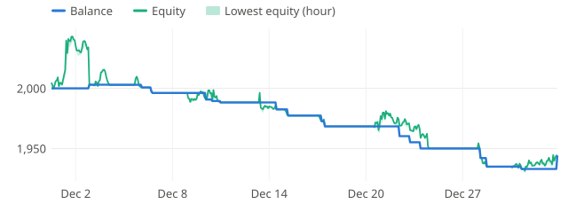

**2023-01** -3.5%

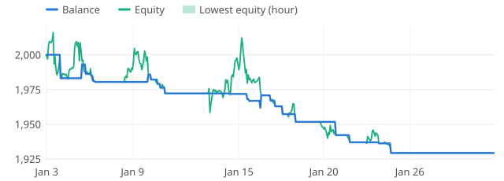

**2023-02** -3.2%

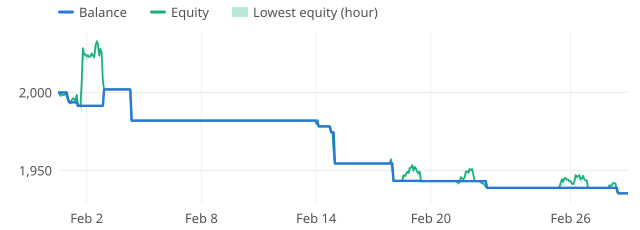

**2023-03** +0.1%

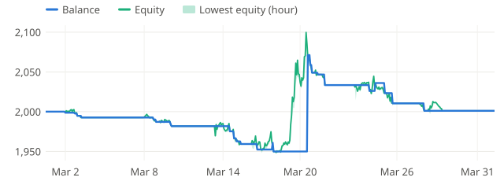

**2023-04** -3.4%

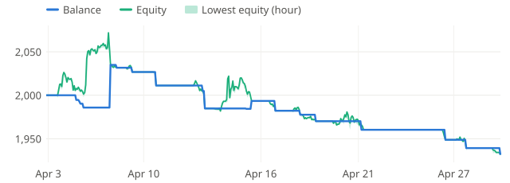

**2023-05** +0.8%

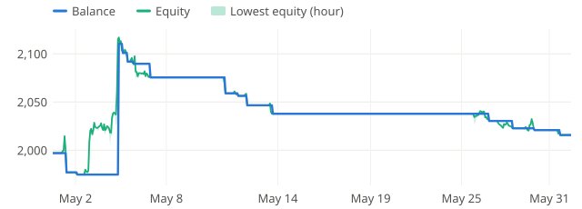

**2023-06** -1.0%

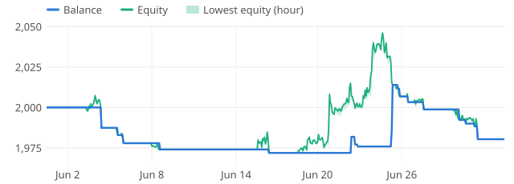

**2023-07** -1.8%

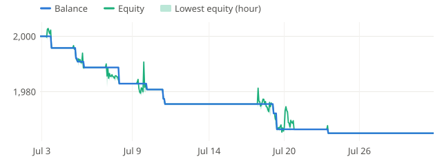

**2023-08** -1.4%

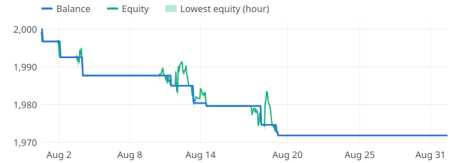

**2023-09** +1.5%

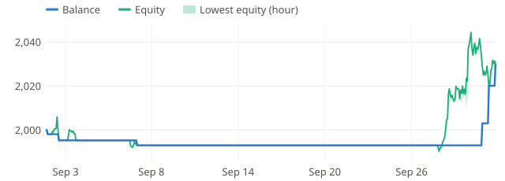

**2023-10** -0.1%

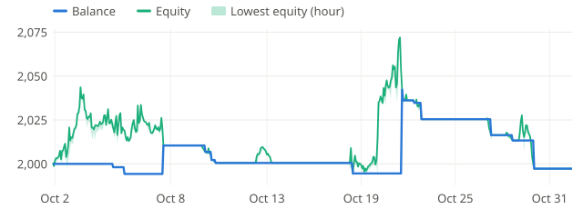

**2023-11** -0.1%

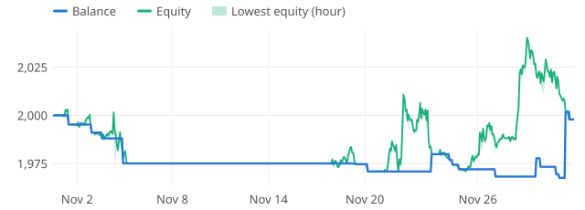

**2023-12** +3.2%

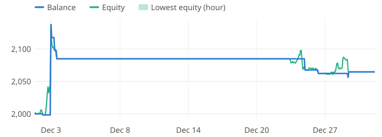

**2024-01** -2.5%

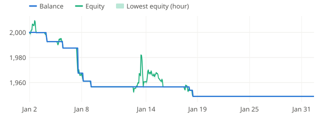

**2024-02** -0.2%

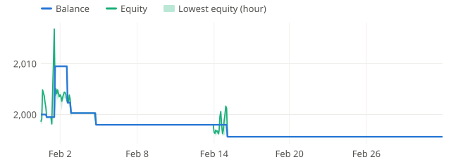

**2024-03** +13.7%

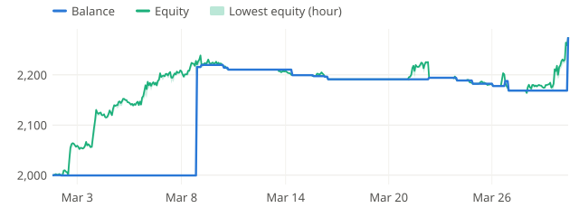

**2024-04** -4.3%

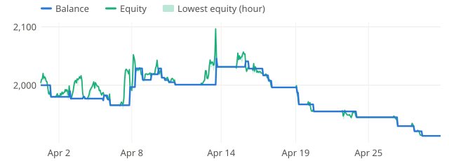

**2024-05** -0.2%

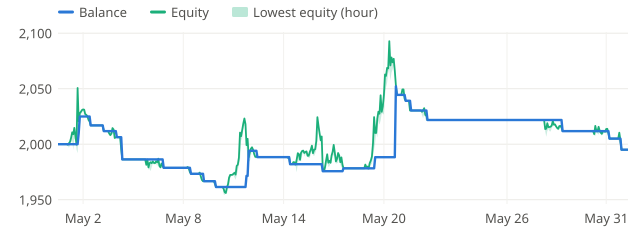

**2024-06** -3.1%

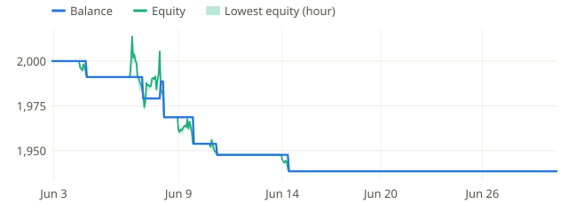

**2024-07** +2.0%

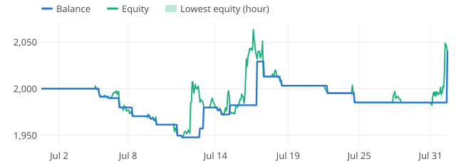

**2024-08** -6.5%

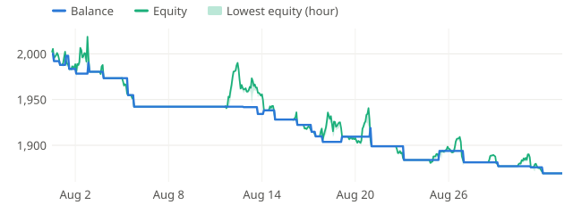

**2024-09** +4.0%

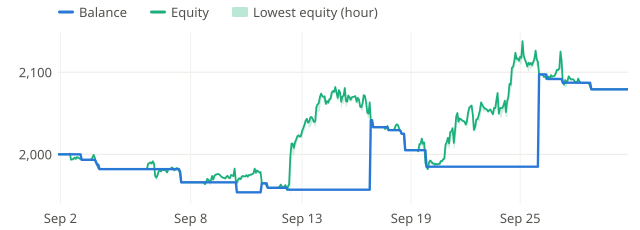

**2024-10** +3.8%

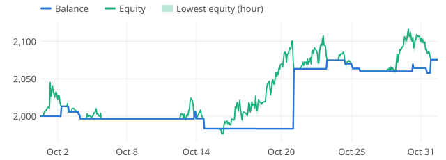

**2024-11** -0.8%

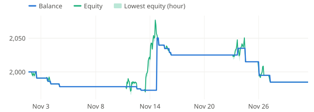

**2024-12** -4.9%

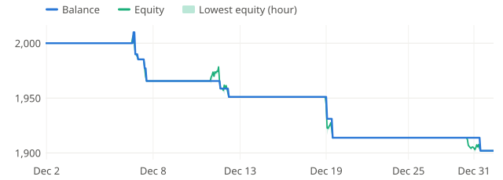
