# Default profile - XAUUSDm M5, generated ticks 2025

| Setting | Value |
|---|---|
| EA | Nyao Scalper v54.0 (`nyao_scalper.mq5`) |
| Settings | `settings/xauusd-default.set` |
| Git commit | b7b5881 |
| Symbol / timeframes | XAUUSDm / M5 |
| Tick data | Every tick (generated) |
| Deposit / leverage | 2,000 USD / 1:500 |
| Runs | One run per month, each starting from a fresh deposit |
| Generated | 2026-10-26 02:06 with `tools/backtest/nyao_backtest.py` |

## Summary

Total return is the sum of the monthly returns (each month starts from the same deposit, not compounded).

| Timeframe | Total return | Profitable | Best / worst run | Max drawdown | Trades | Win rate | Avg win / loss | Profit factor | Tick data |
|---|---|---|---|---|---|---|---|---|---|
| M5 | +65.3% | 10/12 | +15.2% / -1.5% | 11.5% | 538 | 42% | $21.11 / -$11.21 | 1.37 | 100%, 92%, 96% |

## Results per run

| Run | M5 |
|---|---|
| 2025-01 | +4.0% (DD 2%, 22 trades) |
| 2025-02 | +4.9% (DD 5%, 35 trades) |
| 2025-03 | +6.9% (DD 3%, 34 trades) |
| 2025-04 | +11.0% (DD 7%, 62 trades) |
| 2025-05 | +6.1% (DD 9%, 44 trades) |
| 2025-06 | -1.5% (DD 9%, 28 trades) |
| 2025-07 | +1.2% (DD 4%, 17 trades) |
| 2025-08 | +0.2% (DD 5%, 22 trades) |
| 2025-09 | +13.3% (DD 6%, 53 trades) |
| 2025-10 | +15.2% (DD 7%, 105 trades) |
| 2025-11 | -0.1% (DD 12%, 56 trades) |
| 2025-12 | +4.3% (DD 9%, 60 trades) |

## Balance & equity graphs

### M5

**2025-01** +4.0%

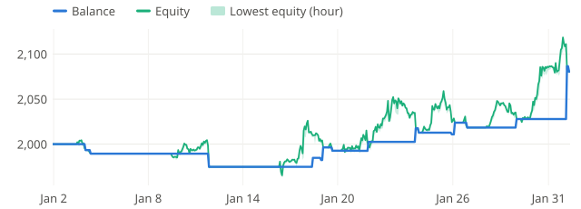

**2025-02** +4.9%

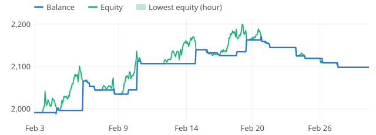

**2025-03** +6.9%

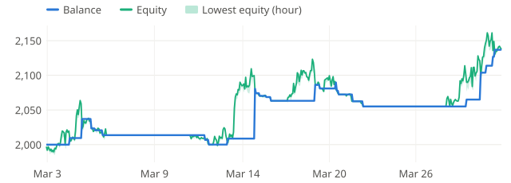

**2025-04** +11.0%

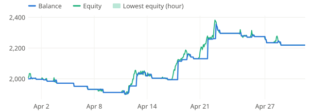

**2025-05** +6.1%

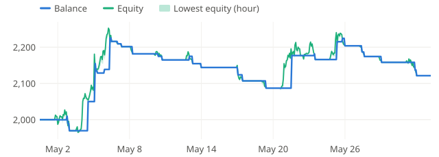

**2025-06** -1.5%

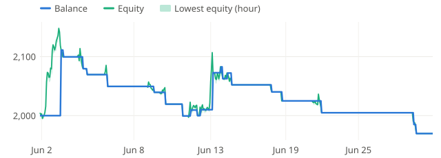

**2025-07** +1.2%

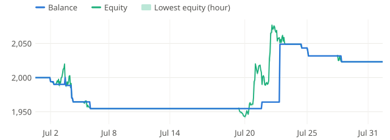

**2025-08** +0.2%

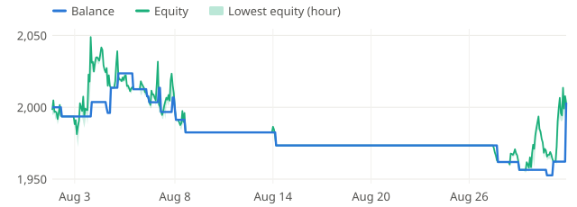

**2025-09** +13.3%

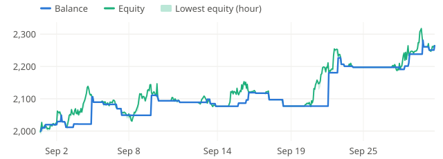

**2025-10** +15.2%

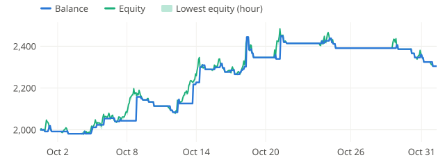

**2025-11** -0.1%

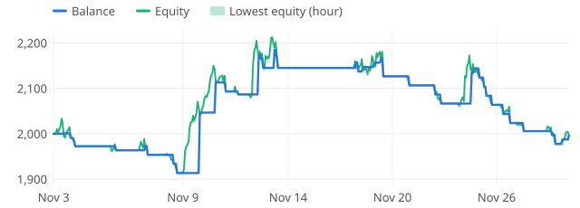

**2025-12** +4.3%

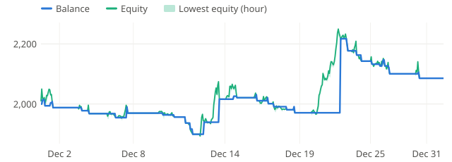
