# High-risk profile - XAUUSDm M5, generated ticks 2022-2024

| Setting | Value |
|---|---|
| EA | Nyao Scalper v54.0 (`nyao_scalper.mq5`) |
| Settings | `settings/xauusd-high-risk.set` |
| Git commit | 66a89db |
| Symbol / timeframes | XAUUSDm / M5 |
| Tick data | Every tick (generated) |
| Deposit / leverage | 2,000 USD / 1:500 |
| Runs | One run per month, each starting from a fresh deposit |
| Generated | 2026-10-26 03:28 with `tools/backtest/nyao_backtest.py` |

## Summary

Total return is the sum of the monthly returns (each month starts from the same deposit, not compounded).

| Timeframe | Total return | Profitable | Best / worst run | Max drawdown | Trades | Win rate | Avg win / loss | Profit factor | Tick data |
|---|---|---|---|---|---|---|---|---|---|
| M5 | -30.8% | 13/36 | +26.6% / -15.7% | 17.7% | 649 | 24% | $37.93 / -$13.04 | 0.90 | 100%, 92%, 96% |

## Results per run

| Run | M5 |
|---|---|
| 2022-01 | -4.8% (DD 5%, 9 trades) |
| 2022-02 | +7.0% (DD 9%, 18 trades) |
| 2022-03 | +3.6% (DD 11%, 32 trades) |
| 2022-04 | -3.2% (DD 7%, 16 trades) |
| 2022-05 | +5.8% (DD 6%, 17 trades) |
| 2022-06 | -7.6% (DD 9%, 13 trades) |
| 2022-07 | -3.7% (DD 8%, 23 trades) |
| 2022-08 | -1.9% (DD 6%, 13 trades) |
| 2022-09 | -2.9% (DD 8%, 19 trades) |
| 2022-10 | -6.1% (DD 8%, 18 trades) |
| 2022-11 | -1.5% (DD 8%, 24 trades) |
| 2022-12 | -2.2% (DD 9%, 22 trades) |
| 2023-01 | +0.9% (DD 5%, 23 trades) |
| 2023-02 | -4.4% (DD 8%, 16 trades) |
| 2023-03 | +0.7% (DD 9%, 30 trades) |
| 2023-04 | -4.1% (DD 11%, 21 trades) |
| 2023-05 | +1.1% (DD 12%, 17 trades) |
| 2023-06 | -1.6% (DD 6%, 16 trades) |
| 2023-07 | -3.9% (DD 4%, 12 trades) |
| 2023-08 | -2.8% (DD 3%, 12 trades) |
| 2023-09 | +3.2% (DD 3%, 8 trades) |
| 2023-10 | -4.7% (DD 9%, 20 trades) |
| 2023-11 | +4.3% (DD 4%, 13 trades) |
| 2023-12 | +7.2% (DD 10%, 12 trades) |
| 2024-01 | -3.5% (DD 5%, 10 trades) |
| 2024-02 | -0.4% (DD 3%, 6 trades) |
| 2024-03 | +26.6% (DD 8%, 17 trades) |
| 2024-04 | -15.7% (DD 18%, 33 trades) |
| 2024-05 | +4.9% (DD 8%, 26 trades) |
| 2024-06 | -4.1% (DD 6%, 5 trades) |
| 2024-07 | +5.7% (DD 7%, 24 trades) |
| 2024-08 | -13.5% (DD 15%, 27 trades) |
| 2024-09 | -3.0% (DD 10%, 26 trades) |
| 2024-10 | +3.5% (DD 8%, 22 trades) |
| 2024-11 | -1.1% (DD 8%, 20 trades) |
| 2024-12 | -8.3% (DD 10%, 9 trades) |

## Balance & equity graphs

### M5

**2022-01** -4.8%

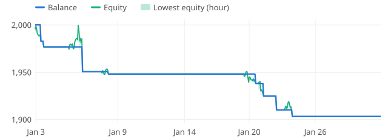

**2022-02** +7.0%

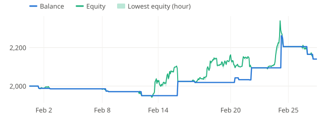

**2022-03** +3.6%

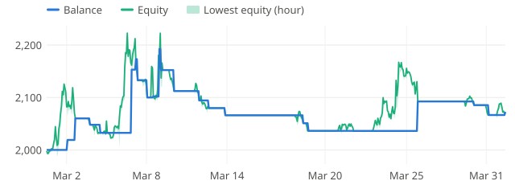

**2022-04** -3.2%

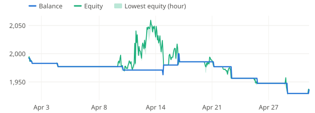

**2022-05** +5.8%

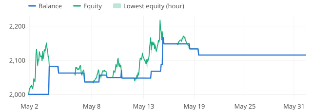

**2022-06** -7.6%

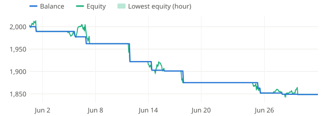

**2022-07** -3.7%

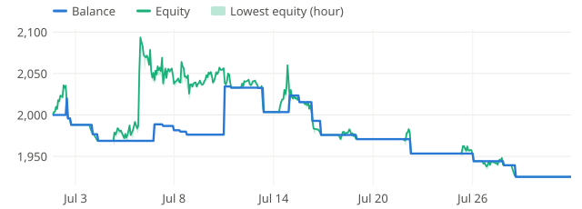

**2022-08** -1.9%

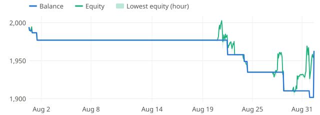

**2022-09** -2.9%

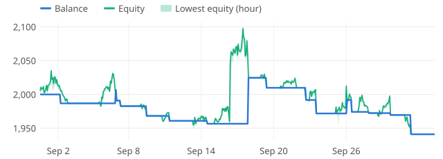

**2022-10** -6.1%

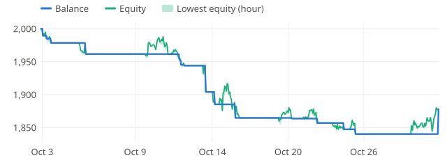

**2022-11** -1.5%

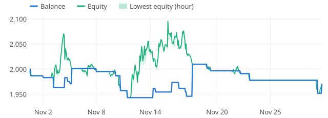

**2022-12** -2.2%

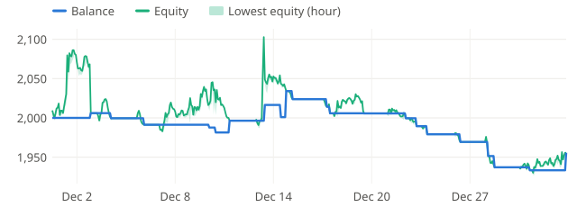

**2023-01** +0.9%

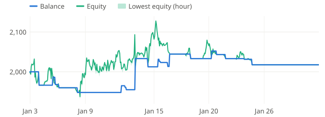

**2023-02** -4.4%

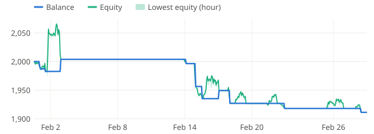

**2023-03** +0.7%

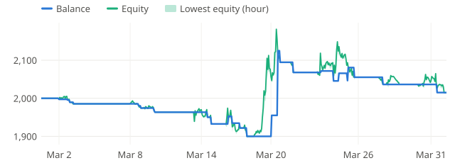

**2023-04** -4.1%

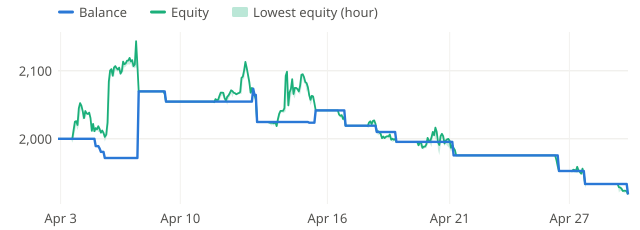

**2023-05** +1.1%

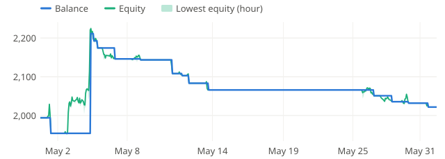

**2023-06** -1.6%

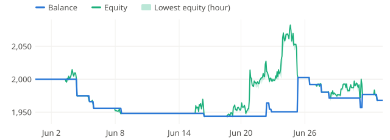

**2023-07** -3.9%

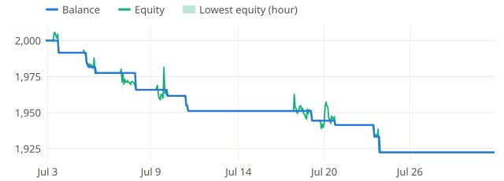

**2023-08** -2.8%

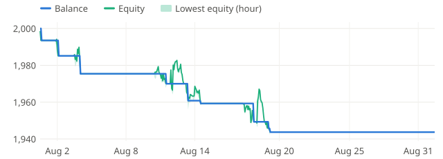

**2023-09** +3.2%

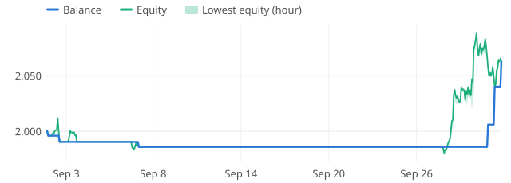

**2023-10** -4.7%

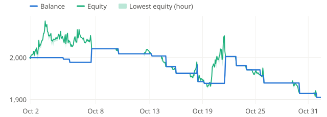

**2023-11** +4.3%

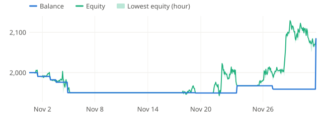

**2023-12** +7.2%

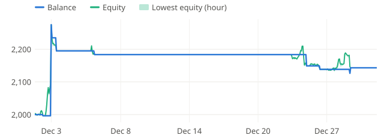

**2024-01** -3.5%

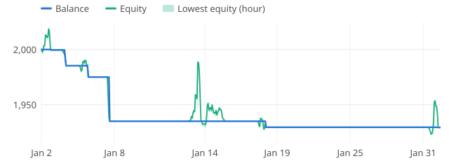

**2024-02** -0.4%

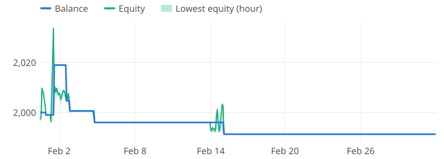

**2024-03** +26.6%

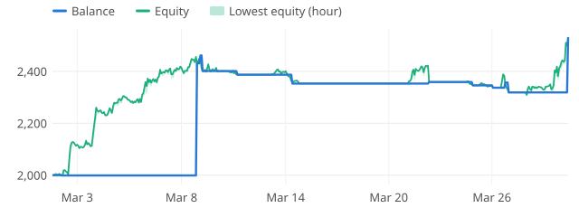

**2024-04** -15.7%

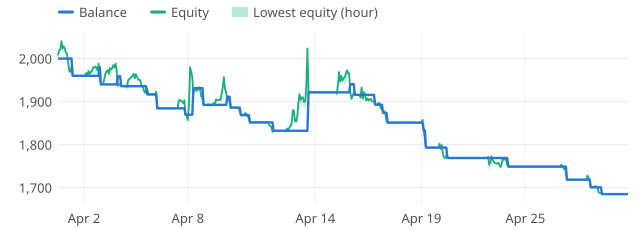

**2024-05** +4.9%

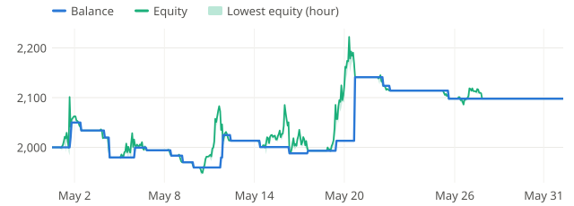

**2024-06** -4.1%

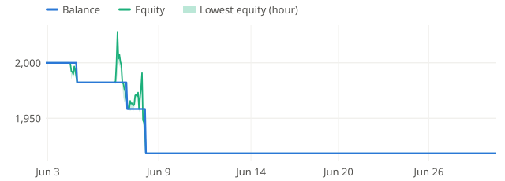

**2024-07** +5.7%

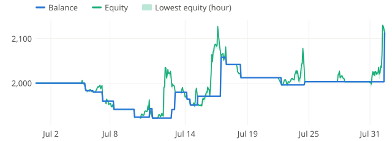

**2024-08** -13.5%

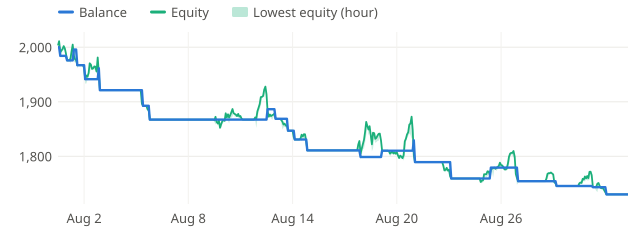

**2024-09** -3.0%

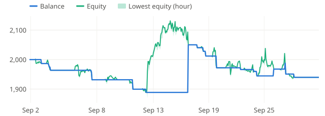

**2024-10** +3.5%

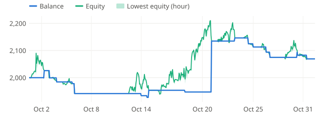

**2024-11** -1.1%

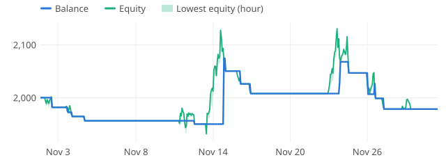

**2024-12** -8.3%

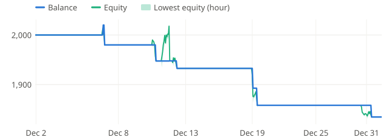
