# High-risk profile - XAUUSDm M5, generated ticks 2025

| Setting | Value |
|---|---|
| EA | Nyao Scalper v54.0 (`nyao_scalper.mq5`) |
| Settings | `settings/xauusd-high-risk.set` |
| Git commit | b7b5881 |
| Symbol / timeframes | XAUUSDm / M5 |
| Tick data | Every tick (generated) |
| Deposit / leverage | 2,000 USD / 1:500 |
| Runs | One run per month, each starting from a fresh deposit |
| Generated | 2026-10-26 02:10 with `tools/backtest/nyao_backtest.py` |

## Summary

Total return is the sum of the monthly returns (each month starts from the same deposit, not compounded).

| Timeframe | Total return | Profitable | Best / worst run | Max drawdown | Trades | Win rate | Avg win / loss | Profit factor | Tick data |
|---|---|---|---|---|---|---|---|---|---|
| M5 | +95.4% | 10/12 | +22.8% / -5.0% | 21.7% | 477 | 43% | $45.33 / -$27.42 | 1.26 | 100%, 92%, 96% |

## Results per run

| Run | M5 |
|---|---|
| 2025-01 | +6.0% (DD 6%, 19 trades) |
| 2025-02 | +7.9% (DD 8%, 28 trades) |
| 2025-03 | +13.7% (DD 9%, 27 trades) |
| 2025-04 | +15.5% (DD 18%, 55 trades) |
| 2025-05 | +6.3% (DD 20%, 42 trades) |
| 2025-06 | +0.2% (DD 13%, 26 trades) |
| 2025-07 | -0.8% (DD 9%, 16 trades) |
| 2025-08 | +1.7% (DD 8%, 15 trades) |
| 2025-09 | +22.8% (DD 12%, 47 trades) |
| 2025-10 | +15.8% (DD 20%, 94 trades) |
| 2025-11 | -5.0% (DD 22%, 54 trades) |
| 2025-12 | +11.1% (DD 15%, 54 trades) |

## Balance & equity graphs

### M5

**2025-01** +6.0%

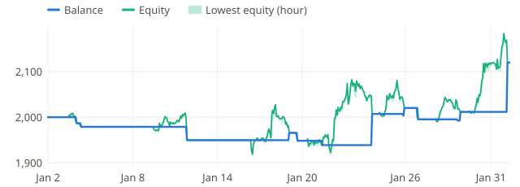

**2025-02** +7.9%

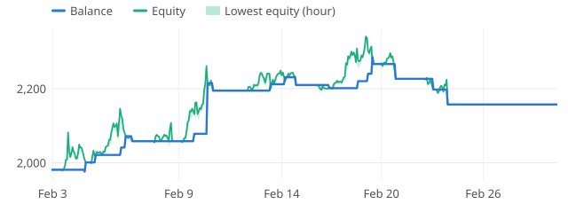

**2025-03** +13.7%

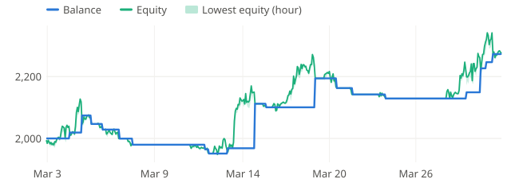

**2025-04** +15.5%

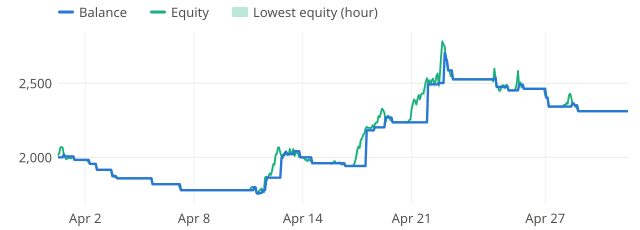

**2025-05** +6.3%

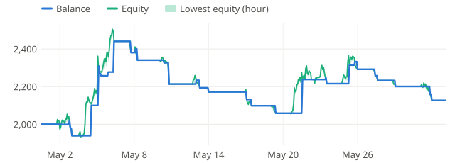

**2025-06** +0.2%

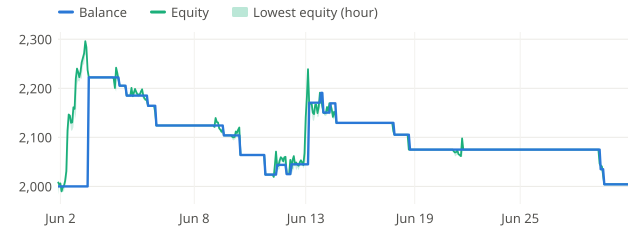

**2025-07** -0.8%

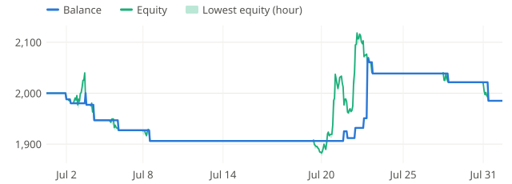

**2025-08** +1.7%

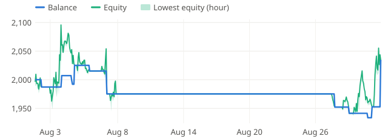

**2025-09** +22.8%

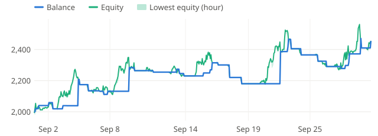

**2025-10** +15.8%

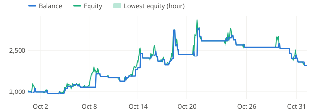

**2025-11** -5.0%

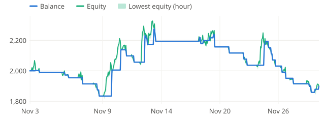

**2025-12** +11.1%

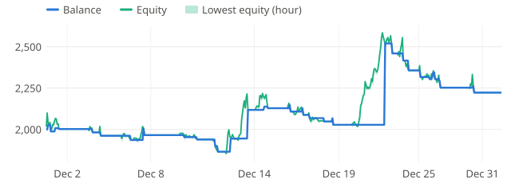
