# High-risk profile - XAUUSDm M1 vs M5, real ticks Jan-Sep 2026

| Setting | Value |
|---|---|
| EA | Nyao Scalper v54.0 (`nyao_scalper.mq5`) |
| Settings | `settings/xauusd-high-risk.set` |
| Git commit | ccbe9df |
| Symbol / timeframes | XAUUSDm / M1, M5 |
| Tick data | Every tick based on real ticks |
| Deposit / leverage | 2,000 USD / 1:500 |
| Runs | One run per month, each starting from a fresh deposit |
| Generated | 2026-10-23 16:58 with `tools/backtest/nyao_backtest.py` |

## Summary

Total return is the sum of the monthly returns (each month starts from the same deposit, not compounded).

| Timeframe | Total return | Profitable | Best / worst run | Max drawdown | Trades | Win rate | Avg win / loss | Profit factor | Tick data |
|---|---|---|---|---|---|---|---|---|---|
| M1 | +20.9% | 5/9 | +50.3% / -24.7% | 47.4% | 1,428 | 36% | $43.08 / -$23.33 | 1.02 | 100% real ticks |
| M5 | +187.6% | 4/9 | +100.6% / -14.4% | 35.5% | 1,071 | 43% | $46.16 / -$28.86 | 1.21 | 100% real ticks |

## Results per run

| Run | M1 | M5 |
|---|---|---|
| 2026-01 | +50.3% (DD 21%, 173 trades) | +99.9% (DD 17%, 154 trades) |
| 2026-02 | -24.7% (DD 47%, 262 trades) | -5.9% (DD 30%, 189 trades) |
| 2026-03 | +9.6% (DD 31%, 280 trades) | -4.6% (DD 33%, 199 trades) |
| 2026-04 | -22.8% (DD 39%, 132 trades) | -14.4% (DD 36%, 87 trades) |
| 2026-05 | -11.3% (DD 30%, 116 trades) | +14.5% (DD 20%, 87 trades) |
| 2026-06 | +16.7% (DD 23%, 168 trades) | +100.6% (DD 19%, 141 trades) |
| 2026-07 | +7.2% (DD 23%, 98 trades) | -1.6% (DD 14%, 66 trades) |
| 2026-08 | -6.5% (DD 23%, 123 trades) | +0.1% (DD 18%, 93 trades) |
| 2026-09 | +2.3% (DD 17%, 76 trades) | -1.2% (DD 23%, 55 trades) |

## Balance & equity graphs

### M1

**2026-01** +50.3%

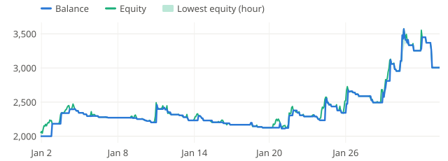

**2026-02** -24.7%

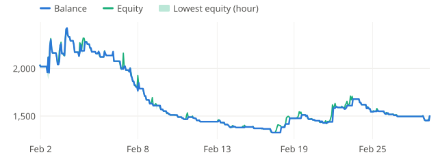

**2026-03** +9.6%

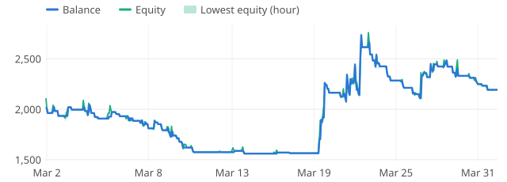

**2026-04** -22.8%

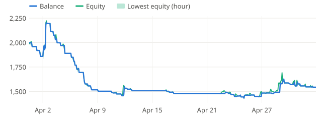

**2026-05** -11.3%

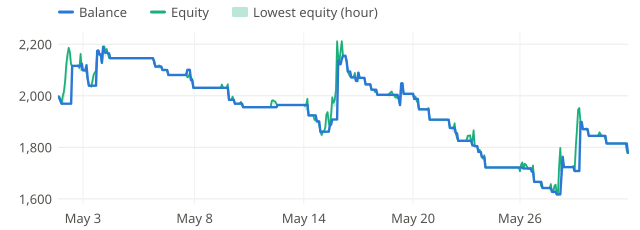

**2026-06** +16.7%

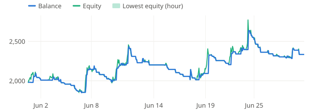

**2026-07** +7.2%

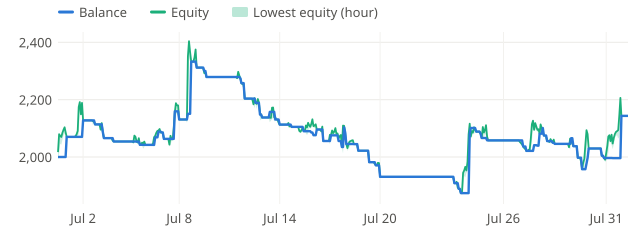

**2026-08** -6.5%

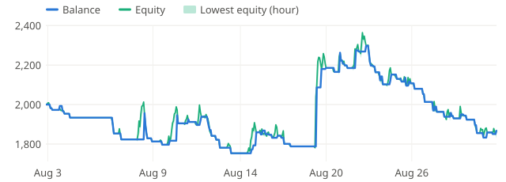

**2026-09** +2.3%

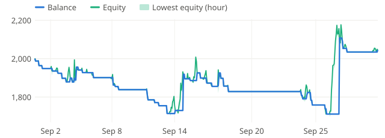

### M5

**2026-01** +99.9%

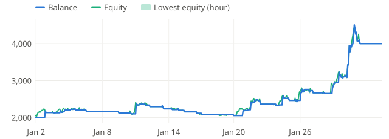

**2026-02** -5.9%

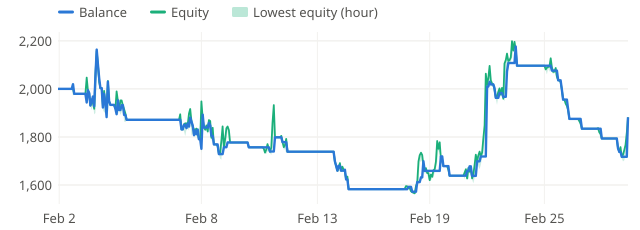

**2026-03** -4.6%

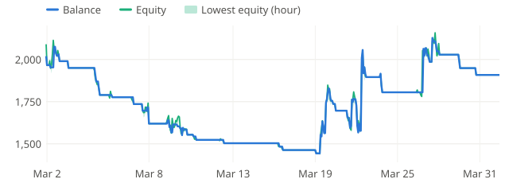

**2026-04** -14.4%

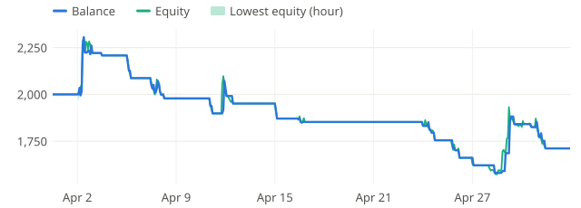

**2026-05** +14.5%

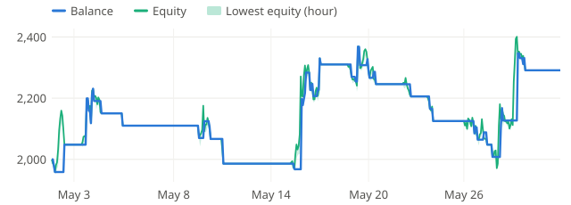

**2026-06** +100.6%

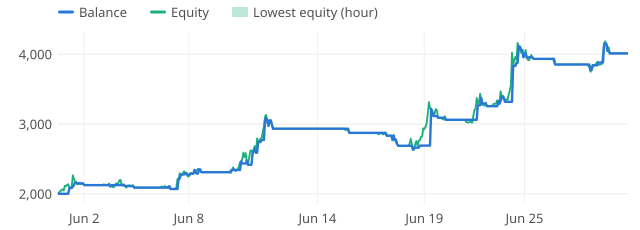

**2026-07** -1.6%

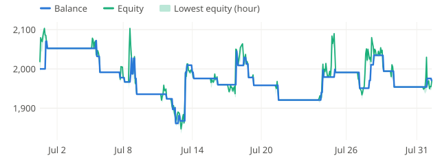

**2026-08** +0.1%

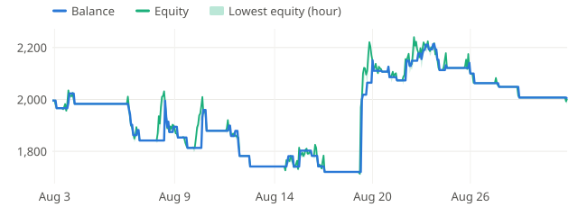

**2026-09** -1.2%

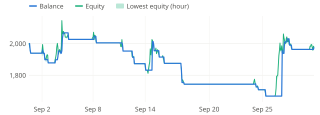
