# Straddle profile - XAUUSDm M1 vs M5, generated ticks 2022-2024 (generated ticks overstate a $1 trailing stop)

| Setting | Value |
|---|---|
| EA | Nyao Straddle v1.5 (`nyao_straddle.mq5`) |
| Settings | `settings/xauusd-straddle.set` |
| Git commit | 66a89db |
| Symbol / timeframes | XAUUSDm / M1, M5 |
| Tick data | Every tick (generated) |
| Deposit / leverage | 2,000 USD / 1:500 |
| Runs | One run per month, each starting from a fresh deposit |
| Generated | 2026-10-26 03:42 with `tools/backtest/nyao_backtest.py` |

## Summary

Total return is the sum of the monthly returns (each month starts from the same deposit, not compounded).

| Timeframe | Total return | Profitable | Best / worst run | Max drawdown | Trades | Win rate | Avg win / loss | Profit factor | Tick data |
|---|---|---|---|---|---|---|---|---|---|
| M1 | +0.0% | 0/36 | +0.0% / +0.0% | 0.0% | 0 | 0% | $0.00 / -$0.00 | - | 100%, 92%, 96% |
| M5 | +0.0% | 0/36 | +0.0% / +0.0% | 0.0% | 0 | 0% | $0.00 / -$0.00 | - | 100%, 92%, 96% |

## Results per run

| Run | M1 | M5 |
|---|---|---|
| 2022-01 | +0.0% (DD 0%, 0 trades) | +0.0% (DD 0%, 0 trades) |
| 2022-02 | +0.0% (DD 0%, 0 trades) | +0.0% (DD 0%, 0 trades) |
| 2022-03 | +0.0% (DD 0%, 0 trades) | +0.0% (DD 0%, 0 trades) |
| 2022-04 | +0.0% (DD 0%, 0 trades) | +0.0% (DD 0%, 0 trades) |
| 2022-05 | +0.0% (DD 0%, 0 trades) | +0.0% (DD 0%, 0 trades) |
| 2022-06 | +0.0% (DD 0%, 0 trades) | +0.0% (DD 0%, 0 trades) |
| 2022-07 | +0.0% (DD 0%, 0 trades) | +0.0% (DD 0%, 0 trades) |
| 2022-08 | +0.0% (DD 0%, 0 trades) | +0.0% (DD 0%, 0 trades) |
| 2022-09 | +0.0% (DD 0%, 0 trades) | +0.0% (DD 0%, 0 trades) |
| 2022-10 | +0.0% (DD 0%, 0 trades) | +0.0% (DD 0%, 0 trades) |
| 2022-11 | +0.0% (DD 0%, 0 trades) | +0.0% (DD 0%, 0 trades) |
| 2022-12 | +0.0% (DD 0%, 0 trades) | +0.0% (DD 0%, 0 trades) |
| 2023-01 | +0.0% (DD 0%, 0 trades) | +0.0% (DD 0%, 0 trades) |
| 2023-02 | +0.0% (DD 0%, 0 trades) | +0.0% (DD 0%, 0 trades) |
| 2023-03 | +0.0% (DD 0%, 0 trades) | +0.0% (DD 0%, 0 trades) |
| 2023-04 | +0.0% (DD 0%, 0 trades) | +0.0% (DD 0%, 0 trades) |
| 2023-05 | +0.0% (DD 0%, 0 trades) | +0.0% (DD 0%, 0 trades) |
| 2023-06 | +0.0% (DD 0%, 0 trades) | +0.0% (DD 0%, 0 trades) |
| 2023-07 | +0.0% (DD 0%, 0 trades) | +0.0% (DD 0%, 0 trades) |
| 2023-08 | +0.0% (DD 0%, 0 trades) | +0.0% (DD 0%, 0 trades) |
| 2023-09 | +0.0% (DD 0%, 0 trades) | +0.0% (DD 0%, 0 trades) |
| 2023-10 | +0.0% (DD 0%, 0 trades) | +0.0% (DD 0%, 0 trades) |
| 2023-11 | +0.0% (DD 0%, 0 trades) | +0.0% (DD 0%, 0 trades) |
| 2023-12 | +0.0% (DD 0%, 0 trades) | +0.0% (DD 0%, 0 trades) |
| 2024-01 | +0.0% (DD 0%, 0 trades) | +0.0% (DD 0%, 0 trades) |
| 2024-02 | +0.0% (DD 0%, 0 trades) | +0.0% (DD 0%, 0 trades) |
| 2024-03 | +0.0% (DD 0%, 0 trades) | +0.0% (DD 0%, 0 trades) |
| 2024-04 | +0.0% (DD 0%, 0 trades) | +0.0% (DD 0%, 0 trades) |
| 2024-05 | +0.0% (DD 0%, 0 trades) | +0.0% (DD 0%, 0 trades) |
| 2024-06 | +0.0% (DD 0%, 0 trades) | +0.0% (DD 0%, 0 trades) |
| 2024-07 | +0.0% (DD 0%, 0 trades) | +0.0% (DD 0%, 0 trades) |
| 2024-08 | +0.0% (DD 0%, 0 trades) | +0.0% (DD 0%, 0 trades) |
| 2024-09 | +0.0% (DD 0%, 0 trades) | +0.0% (DD 0%, 0 trades) |
| 2024-10 | +0.0% (DD 0%, 0 trades) | +0.0% (DD 0%, 0 trades) |
| 2024-11 | +0.0% (DD 0%, 0 trades) | +0.0% (DD 0%, 0 trades) |
| 2024-12 | +0.0% (DD 0%, 0 trades) | +0.0% (DD 0%, 0 trades) |

## Balance & equity graphs

### M1

**2022-01** +0.0%

**2022-02** +0.0%

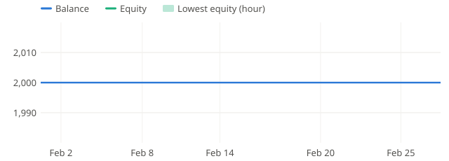

**2022-03** +0.0%

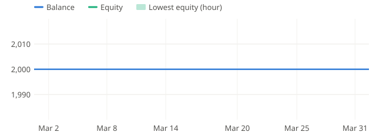

**2022-04** +0.0%

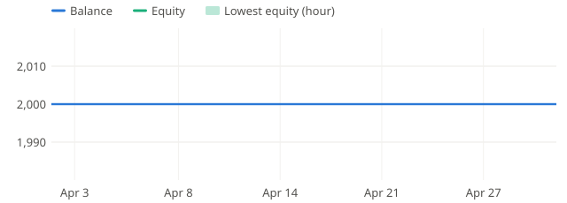

**2022-05** +0.0%

**2022-06** +0.0%

**2022-07** +0.0%

**2022-08** +0.0%

**2022-09** +0.0%

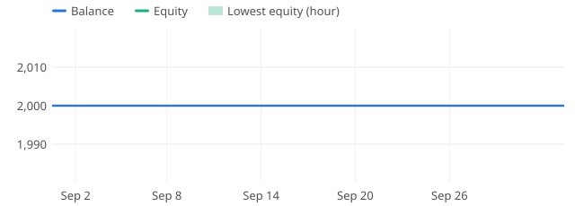

**2022-10** +0.0%

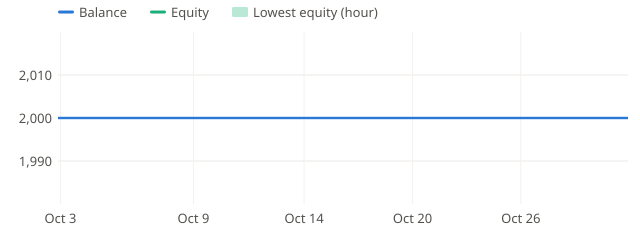

**2022-11** +0.0%

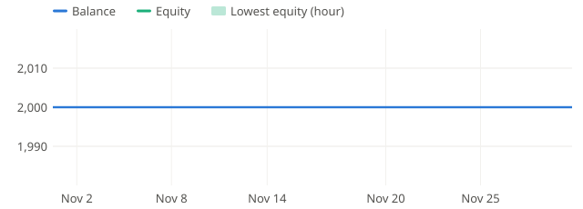

**2022-12** +0.0%

**2023-01** +0.0%

**2023-02** +0.0%

**2023-03** +0.0%

**2023-04** +0.0%

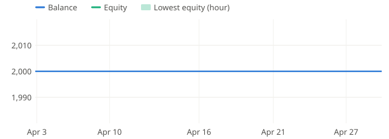

**2023-05** +0.0%

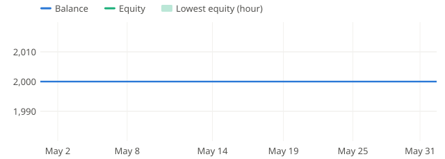

**2023-06** +0.0%

**2023-07** +0.0%

**2023-08** +0.0%

**2023-09** +0.0%

**2023-10** +0.0%

**2023-11** +0.0%

**2023-12** +0.0%

**2024-01** +0.0%

**2024-02** +0.0%

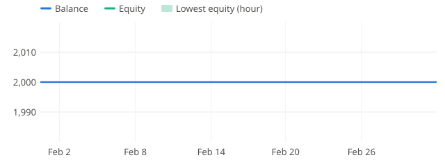

**2024-03** +0.0%

**2024-04** +0.0%

**2024-05** +0.0%

**2024-06** +0.0%

**2024-07** +0.0%

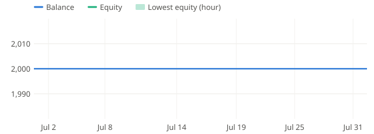

**2024-08** +0.0%

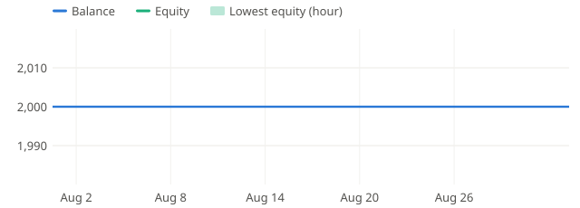

**2024-09** +0.0%

**2024-10** +0.0%

**2024-11** +0.0%

**2024-12** +0.0%

### M5

**2022-01** +0.0%

**2022-02** +0.0%

**2022-03** +0.0%

**2022-04** +0.0%

**2022-05** +0.0%

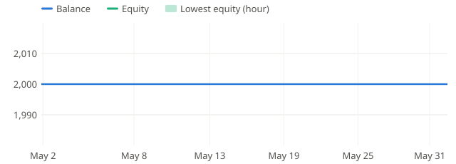

**2022-06** +0.0%

**2022-07** +0.0%

**2022-08** +0.0%

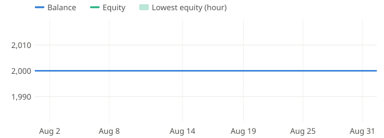

**2022-09** +0.0%

**2022-10** +0.0%

**2022-11** +0.0%

**2022-12** +0.0%

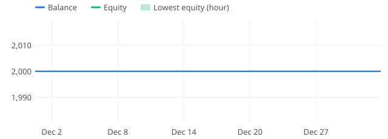

**2023-01** +0.0%

**2023-02** +0.0%

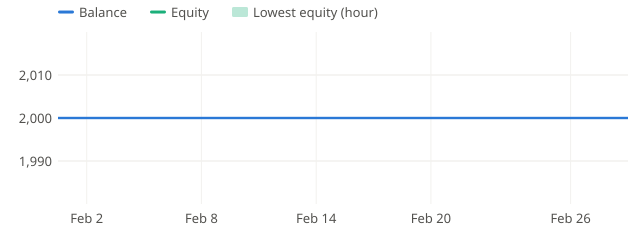

**2023-03** +0.0%

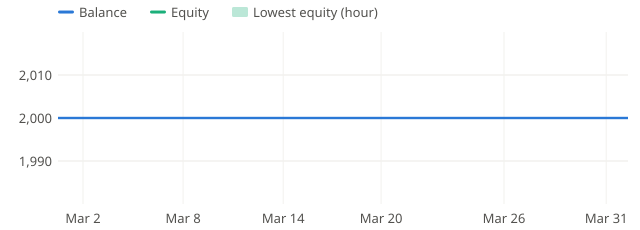

**2023-04** +0.0%

**2023-05** +0.0%

**2023-06** +0.0%

**2023-07** +0.0%

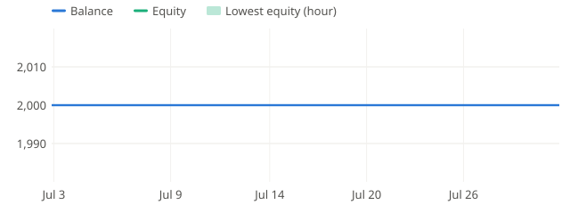

**2023-08** +0.0%

**2023-09** +0.0%

**2023-10** +0.0%

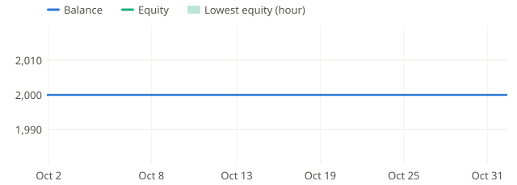

**2023-11** +0.0%

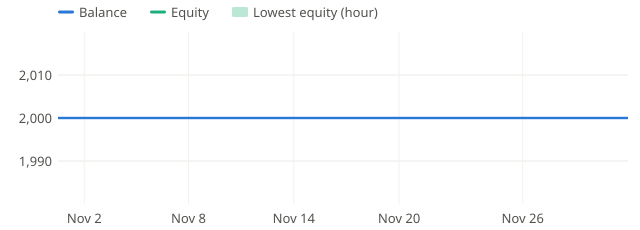

**2023-12** +0.0%

**2024-01** +0.0%

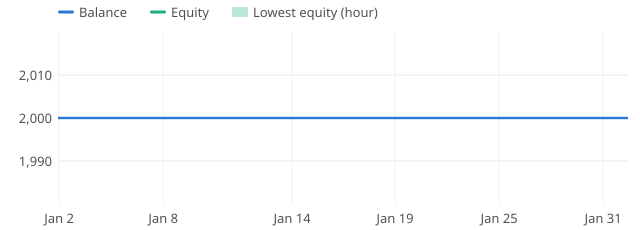

**2024-02** +0.0%

**2024-03** +0.0%

**2024-04** +0.0%

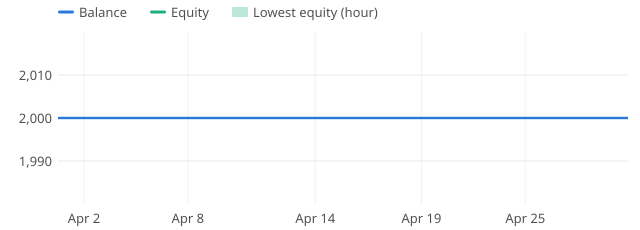

**2024-05** +0.0%

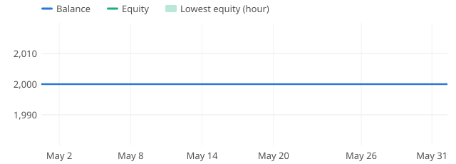

**2024-06** +0.0%

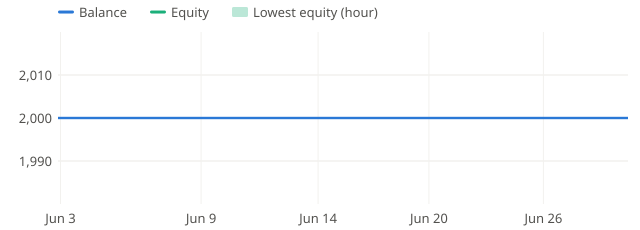

**2024-07** +0.0%

**2024-08** +0.0%

**2024-09** +0.0%

**2024-10** +0.0%

**2024-11** +0.0%

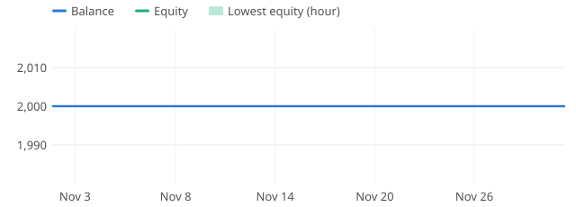

**2024-12** +0.0%

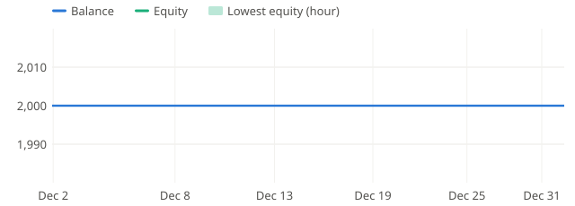
