# Straddle profile - XAUUSDm M1 vs M5, generated ticks 2025 (generated ticks overstate a $1 trailing stop)

| Setting | Value |
|---|---|
| EA | Nyao Straddle v1.5 (`nyao_straddle.mq5`) |
| Settings | `settings/xauusd-straddle.set` |
| Git commit | 66a89db |
| Symbol / timeframes | XAUUSDm / M1, M5 |
| Tick data | Every tick (generated) |
| Deposit / leverage | 2,000 USD / 1:500 |
| Runs | One run per month, each starting from a fresh deposit |
| Generated | 2026-10-26 03:16 with `tools/backtest/nyao_backtest.py` |

## Summary

Total return is the sum of the monthly returns (each month starts from the same deposit, not compounded).

| Timeframe | Total return | Profitable | Best / worst run | Max drawdown | Trades | Win rate | Avg win / loss | Profit factor | Tick data |
|---|---|---|---|---|---|---|---|---|---|
| M1 | +37.6% | 1/12 | +37.6% / +0.0% | 0.1% | 194 | 83% | $4.79 / -$0.56 | 41.84 | 100%, 92%, 96% |
| M5 | +42.1% | 1/12 | +42.1% / +0.0% | 0.1% | 264 | 84% | $3.90 / -$0.46 | 43.46 | 100%, 92%, 96% |

## Results per run

| Run | M1 | M5 |
|---|---|---|
| 2025-01 | +0.0% (DD 0%, 0 trades) | +0.0% (DD 0%, 0 trades) |
| 2025-02 | +0.0% (DD 0%, 0 trades) | +0.0% (DD 0%, 0 trades) |
| 2025-03 | +0.0% (DD 0%, 0 trades) | +0.0% (DD 0%, 0 trades) |
| 2025-04 | +0.0% (DD 0%, 0 trades) | +0.0% (DD 0%, 0 trades) |
| 2025-05 | +0.0% (DD 0%, 0 trades) | +0.0% (DD 0%, 0 trades) |
| 2025-06 | +0.0% (DD 0%, 0 trades) | +0.0% (DD 0%, 0 trades) |
| 2025-07 | +0.0% (DD 0%, 0 trades) | +0.0% (DD 0%, 0 trades) |
| 2025-08 | +0.0% (DD 0%, 0 trades) | +0.0% (DD 0%, 0 trades) |
| 2025-09 | +0.0% (DD 0%, 0 trades) | +0.0% (DD 0%, 0 trades) |
| 2025-10 | +37.6% (DD 0%, 194 trades) | +42.1% (DD 0%, 264 trades) |
| 2025-11 | +0.0% (DD 0%, 0 trades) | +0.0% (DD 0%, 0 trades) |
| 2025-12 | +0.0% (DD 0%, 0 trades) | +0.0% (DD 0%, 0 trades) |

## Balance & equity graphs

### M1

**2025-01** +0.0%

**2025-02** +0.0%

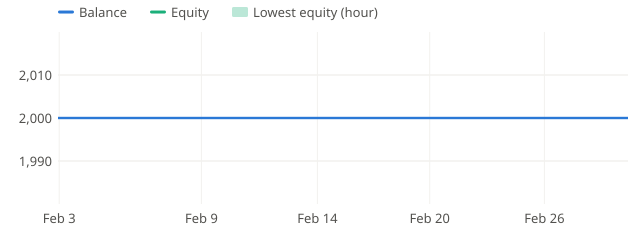

**2025-03** +0.0%

**2025-04** +0.0%

**2025-05** +0.0%

**2025-06** +0.0%

**2025-07** +0.0%

**2025-08** +0.0%

**2025-09** +0.0%

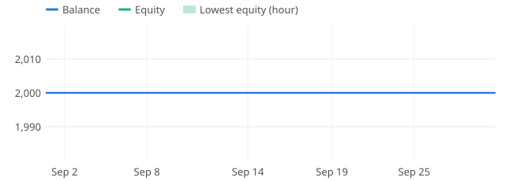

**2025-10** +37.6%

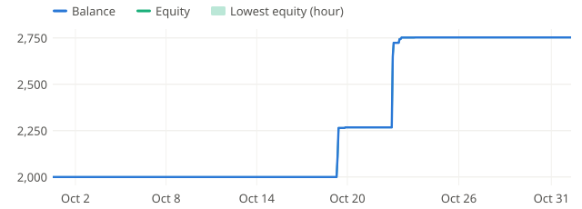

**2025-11** +0.0%

**2025-12** +0.0%

### M5

**2025-01** +0.0%

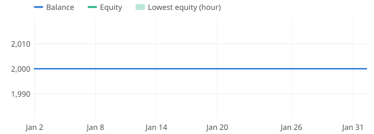

**2025-02** +0.0%

**2025-03** +0.0%

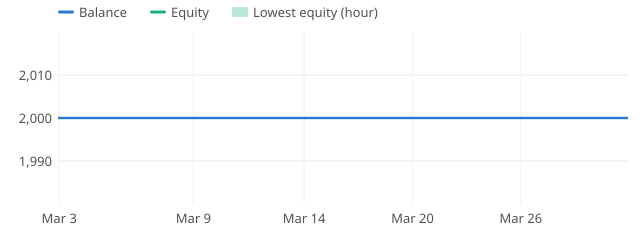

**2025-04** +0.0%

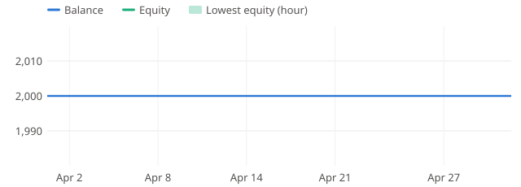

**2025-05** +0.0%

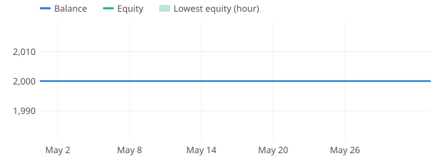

**2025-06** +0.0%

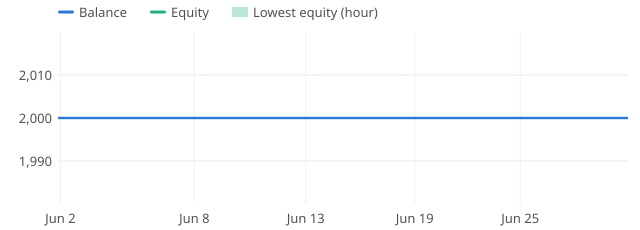

**2025-07** +0.0%

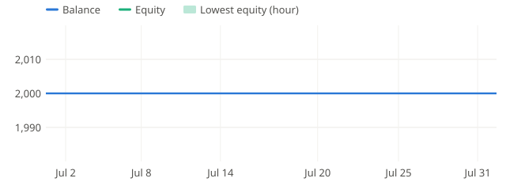

**2025-08** +0.0%

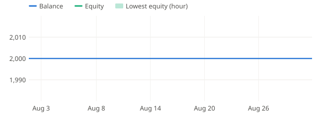

**2025-09** +0.0%

**2025-10** +42.1%

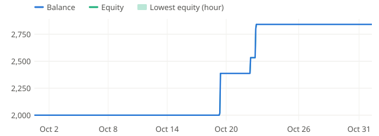

**2025-11** +0.0%

**2025-12** +0.0%

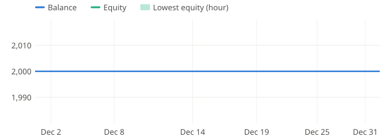
