# Straddle profile - XAUUSDm M1 vs M5, real ticks Jan-Sep 2026

| Setting | Value |
|---|---|
| EA | Nyao Straddle v1.5 (`nyao_straddle.mq5`) |
| Settings | `settings/xauusd-straddle.set` |
| Git commit | b7b5881 |
| Symbol / timeframes | XAUUSDm / M1, M5 |
| Tick data | Every tick based on real ticks |
| Deposit / leverage | 2,000 USD / 1:500 |
| Runs | One run per month, each starting from a fresh deposit |
| Generated | 2026-10-26 01:58 with `tools/backtest/nyao_backtest.py` |

## Summary

Total return is the sum of the monthly returns (each month starts from the same deposit, not compounded).

| Timeframe | Total return | Profitable | Best / worst run | Max drawdown | Trades | Win rate | Avg win / loss | Profit factor | Tick data |
|---|---|---|---|---|---|---|---|---|---|
| M1 | +239.0% | 4/9 | +120.0% / -0.2% | 2.7% | 9,985 | 45% | $2.12 / -$0.85 | 2.02 | 100% real ticks |
| M5 | +184.5% | 4/9 | +109.7% / +0.0% | 4.0% | 10,486 | 43% | $1.93 / -$0.84 | 1.74 | 100% real ticks |

## Results per run

| Run | M1 | M5 |
|---|---|---|
| 2026-01 | +120.0% (DD 2%, 3195 trades) | +109.7% (DD 1%, 3675 trades) |
| 2026-02 | +75.5% (DD 1%, 3210 trades) | +27.7% (DD 1%, 1827 trades) |
| 2026-03 | +33.0% (DD 3%, 2941 trades) | +45.5% (DD 4%, 4541 trades) |
| 2026-04 | +10.7% (DD 1%, 617 trades) | +1.5% (DD 1%, 443 trades) |
| 2026-05 | +0.0% (DD 0%, 0 trades) | +0.0% (DD 0%, 0 trades) |
| 2026-06 | -0.2% (DD 0%, 22 trades) | +0.0% (DD 0%, 0 trades) |
| 2026-07 | +0.0% (DD 0%, 0 trades) | +0.0% (DD 0%, 0 trades) |
| 2026-08 | +0.0% (DD 0%, 0 trades) | +0.0% (DD 0%, 0 trades) |
| 2026-09 | +0.0% (DD 0%, 0 trades) | +0.0% (DD 0%, 0 trades) |

## Balance & equity graphs

### M1

**2026-01** +120.0%

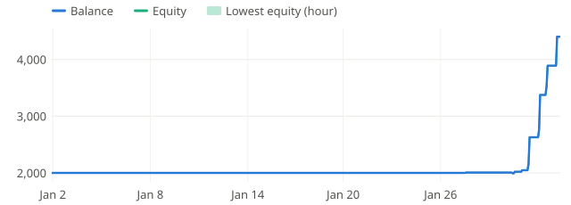

**2026-02** +75.5%

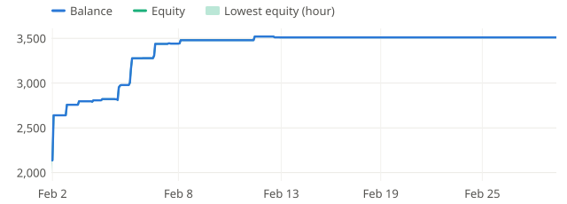

**2026-03** +33.0%

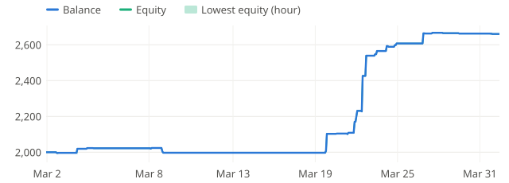

**2026-04** +10.7%

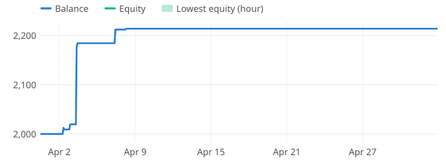

**2026-05** +0.0%

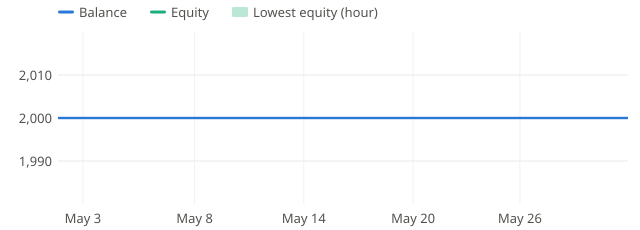

**2026-06** -0.2%

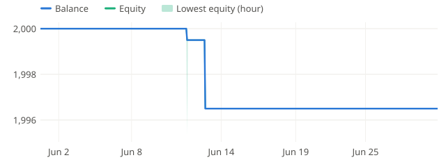

**2026-07** +0.0%

**2026-08** +0.0%

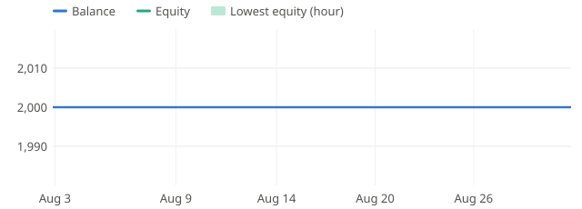

**2026-09** +0.0%

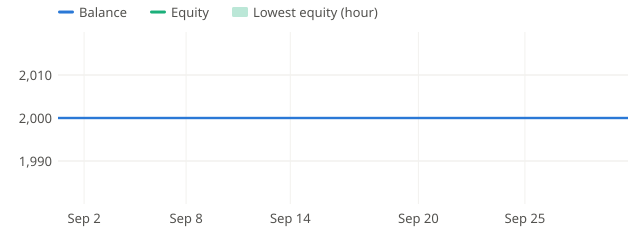

### M5

**2026-01** +109.7%

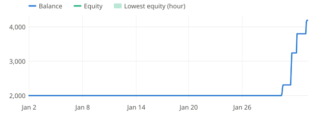

**2026-02** +27.7%

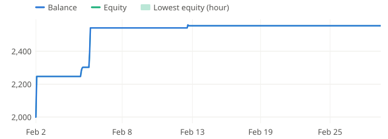

**2026-03** +45.5%

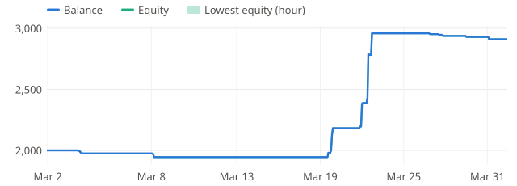

**2026-04** +1.5%

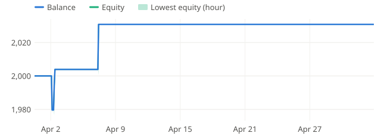

**2026-05** +0.0%

**2026-06** +0.0%

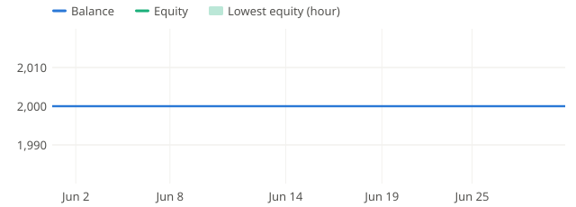

**2026-07** +0.0%

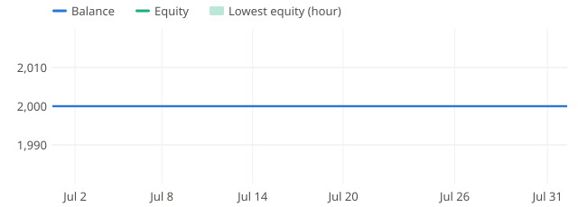

**2026-08** +0.0%

**2026-09** +0.0%

